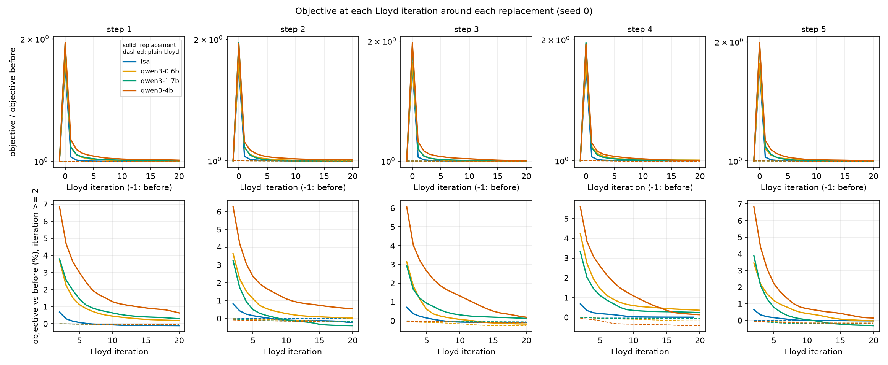
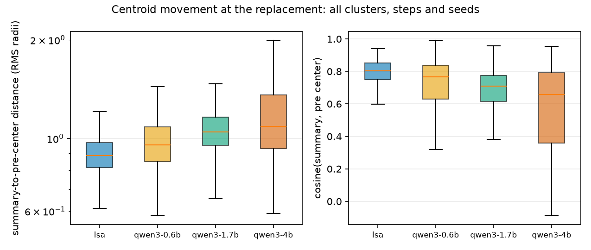

# What happens when a summary replaces a centroid: the replacement diagnostic on CLINC150

Issue #33. Preliminary: five seeds, one dataset, summary embeddings re-computed on a CPU (see Section 2). Measurement and explanation are kept apart: Sections 3 to 7 report what was measured, Section 8 lists what is and is not concluded. No causal claim is made here; testing causes is #47.

## 1. What was measured and how

The logged CLINC150 runs (#31: LSA, Qwen3-0.6B, 1.7B and 4B, seeds 0-4, 5 summary steps, 20 Lloyd iterations per block, `initial_iter` and `final_iter` on) were replayed offline with `kslimeans.replay`. No language model was called. Each Lloyd block is deterministic given its start centers, so the logged summaries were embedded again (`scripts/embed_logged_summaries.py`, the same one-call-per-step encoding as core), and every block was re-run one iteration at a time with sklearn's own Lloyd step (empty-cluster relocation, the tol stop and the strict-convergence stop all as in a single fit). The replay also runs the counterfactual **no replacement**: plain Lloyd iterations from the pre-replacement state (the previous block's final centers, which the logs do not hold) for the same number of iterations.

The measures are in `kslimeans.diagnostic` (definitions in its docstring). The ones that need a convention:

- **Step numbering** is 1-based: step 1 is the first replacement. Every method starts step 1 from the same step-0 partition (`step0_sha1`), so cluster `c` has the same members for every summarizer at step 1 and differences there come from the summarizers alone. Step 0 was replayed exactly for all 20 (method, seed) pairs.
- **J** is the k-means objective (sum of squared distances to the nearest center). *Before* is the objective of the pre-replacement centers; *old assignment* uses the summary centers with every point kept in its old cluster; *replaced* re-assigns every point to the nearest summary center (the logged `summary_inertia`); *end* is after the block.
- **Centroid movement** is the distance from a cluster's pre-replacement center to its summary embedding in units of that cluster's RMS radius (the drift of #15), and their cosine.
- **Movers** are points whose label changes, at the replacement (versus the pre partition) and net over the block (end versus pre). The **gold direction** uses the majority gold label of each cluster *in the pre partition* (ties go to the smallest label): a mover from `a` to `b` moves *toward* its gold label if `majority[b]` is its label and `majority[a]` is not, *away* if the reverse, otherwise *neutral*.
- **Boundary versus core** is a convention, not a derived quantity: a point is a boundary point if its pre-replacement margin (distance to the second-nearest pre center minus the nearest) is in the lowest quartile of that step's margins.
- **Flags** are the §2.4 surface rules (`kslimeans.surface`): *dup* (the summary is identical to another cluster's at that step), *meta* ("cluster" or "summar" appears), *flagged* is either. #34's genericity flag is not available yet.
- **Out-of-date summaries**: a displayed summary is out of date if the Jaccard similarity between the members it was written from and its cluster's final members is below a threshold (0.5 is the documented convention; 0.3 and 0.7 are reported), or its embedding is nearest to another cluster's final center. Empty summaries are excluded.

Outputs (all under `docs/results/`, prefix `replacement_diagnostic_`): `verification.csv`, `steps.csv` (one row per method, seed and step), `iterations.csv` (per iteration, replay and counterfactual), `clusters.csv` (one row per method, seed, step and cluster; key `run, method, seed, step, cluster`, for joins by #34 and #50), `stale.csv` (same key), `outcome.csv`, `sensitivity*.csv`, `tables.md` (all tables, including the pooled-over-steps ones), `examples.md`, and the two figures. Per-point mover files (about 5 MB) stay out of git (`results/`).

## 2. Verification of the replay, and the noise floor

Every fit of every run was compared with the log: replayed labels against `assignments_evolution`, `n_iter` against `last_n_iter`, and the objective at the start and end of each block against `summary_inertia` and `inertia`.

| run | method | fits | exact_fits | mismatched_points_median | mismatched_points_max | n_iter_differs | max_rel_err_summary_inertia | max_rel_err_inertia |
| --- | --- | ---: | ---: | ---: | ---: | ---: | ---: | ---: |
| clinc150_lsa | k-NLPmeans | 30 | 29 | 0 | 6 | 0 | 3.88e-08 | 3.11e-06 |
| clinc150_qwen3-0.6b | k-SLMmeans | 30 | 26 | 0 | 1180 | 0 | 2.84e-08 | 2.08e-03 |
| clinc150_qwen3-1.7b | k-SLMmeans | 30 | 28 | 0 | 630 | 0 | 4.48e-08 | 2.03e-03 |
| clinc150_qwen3-4b | k-SLMmeans | 30 | 8 | 778 | 2057 | 0 | 3.72e-08 | 2.14e-03 |

The summary embeddings used here were computed **on a CPU** (`results/replacement_diagnostic/summary_embeddings_cpu.npz`: torch 2.14.0, sentence-transformers 6.0.1, batch size 32); the original runs encoded on a GPU.

- **Step 0 is exact** for all 20 (method, seed) pairs (0 label mismatches, same `n_iter`), and the number of iterations matches the trace in all 120 fits.
- **The replay mechanism is exact.** From the same start centers, the replayed block gives 0 label mismatches against a real `KMeans(init=start, max_iter=20)` fit (checked on the 4B, seed 0, step 1; `tests/test_replay.py` checks it on synthetic data including empty clusters, identical centers, both stops and every iteration prefix).
- **Blocks do not always match the logs.** `exact_fits` counts fits including the five exact step-0 fits, so the 25 blocks per method are exact in 24 (LSA), 21 (0.6B), 23 (1.7B) and 3 (4B) cases. The worst mismatches are 6 points for LSA, 1,180 (0.6B), 630 (1.7B) and 2,057 (4B) of 22,500; the 4B's median over its 30 fits is 778 points. Where labels differ the end objective differs by up to 0.2%; the start objective agrees to 5e-8 in every fit.
- **Cause: very likely GPU versus CPU encoder noise (unconfirmed).** A CPU re-encode of 300 dataset texts differs from the cached (GPU) embeddings by a median 1.0e-6 (L2 per row), and no row is bit-equal. The summary-embedding start objectives differ by 3e-8 to 4.5e-8, which a bit-identical encoder would not give. Adding noise of that size to the start centers reproduces mismatches of the observed size (next table). Whether a GPU encode of the summaries makes the replay exact is not yet tested. CONFIRM(#33).

### Sensitivity to noise in the start centers

For each method, seeds 0-2 and steps 1, 3 and 5, the block was replayed from the CPU embeddings (reference) and from copies perturbed by `start * (1 + rel * N(0, 1))`, 2 draws per size (fixed seeds). `iid` perturbs every row independently, so identical start centers stop being identical; `tied` gives identical rows the same noise, so ties stay exact. "Tied points" are those assigned at the replacement to a center that has an identical twin. Columns report the share of the 22,500 labels that differ from the reference after the block, the ARI between the two partitions, and the mean absolute change of ACC, NMI and ARI against gold.

| model | noise | rel. noise | tied clusters | labels changed | of tied points | of other points | ARI vs reference | mean abs dACC | mean abs dNMI | mean abs dARI |
| --- | --- | ---: | ---: | ---: | ---: | ---: | ---: | ---: | ---: | ---: |
| lsa | iid | 1e-09 | 0.0 | 0.000 | n/a | 0.000 | 1.0000 | 0.0000 | 0.0000 | 0.0000 |
| lsa | iid | 1e-08 | 0.0 | 0.000 | n/a | 0.000 | 1.0000 | 0.0000 | 0.0000 | 0.0000 |
| lsa | iid | 1e-07 | 0.0 | 0.000 | n/a | 0.000 | 1.0000 | 0.0000 | 0.0000 | 0.0000 |
| lsa | iid | 1e-06 | 0.0 | 0.000 | n/a | 0.000 | 1.0000 | 0.0000 | 0.0000 | 0.0000 |
| lsa | tied | 1e-07 | 0.0 | 0.000 | n/a | 0.000 | 1.0000 | 0.0000 | 0.0000 | 0.0000 |
| lsa | tied | 1e-06 | 0.0 | 0.000 | n/a | 0.000 | 1.0000 | 0.0000 | 0.0000 | 0.0000 |
| qwen3-0.6b | iid | 1e-09 | 1.1 | 0.000 | 0.000 | 0.000 | 1.0000 | 0.0000 | 0.0000 | 0.0000 |
| qwen3-0.6b | iid | 1e-08 | 1.1 | 0.000 | 0.000 | 0.000 | 1.0000 | 0.0000 | 0.0000 | 0.0000 |
| qwen3-0.6b | iid | 1e-07 | 1.1 | 0.016 | 0.385 | 0.015 | 0.9776 | 0.0010 | 0.0005 | 0.0006 |
| qwen3-0.6b | iid | 1e-06 | 1.1 | 0.010 | 0.359 | 0.010 | 0.9850 | 0.0012 | 0.0005 | 0.0007 |
| qwen3-0.6b | tied | 1e-07 | 1.1 | 0.001 | 0.006 | 0.001 | 0.9988 | 0.0000 | 0.0000 | 0.0001 |
| qwen3-0.6b | tied | 1e-06 | 1.1 | 0.001 | 0.069 | 0.001 | 0.9978 | 0.0000 | 0.0001 | 0.0001 |
| qwen3-1.7b | iid | 1e-09 | 0.9 | 0.000 | 0.000 | 0.000 | 1.0000 | 0.0000 | 0.0000 | 0.0000 |
| qwen3-1.7b | iid | 1e-08 | 0.9 | 0.000 | 0.000 | 0.000 | 1.0000 | 0.0000 | 0.0000 | 0.0000 |
| qwen3-1.7b | iid | 1e-07 | 0.9 | 0.010 | 0.263 | 0.009 | 0.9852 | 0.0006 | 0.0002 | 0.0006 |
| qwen3-1.7b | iid | 1e-06 | 0.9 | 0.012 | 0.391 | 0.011 | 0.9837 | 0.0009 | 0.0004 | 0.0005 |
| qwen3-1.7b | tied | 1e-07 | 0.9 | 0.000 | 0.000 | 0.000 | 1.0000 | 0.0000 | 0.0000 | 0.0000 |
| qwen3-1.7b | tied | 1e-06 | 0.9 | 0.000 | 0.000 | 0.000 | 1.0000 | 0.0000 | 0.0000 | 0.0000 |
| qwen3-4b | iid | 1e-09 | 17.4 | 0.000 | 0.000 | 0.000 | 1.0000 | 0.0000 | 0.0000 | 0.0000 |
| qwen3-4b | iid | 1e-08 | 17.4 | 0.008 | 0.024 | 0.007 | 0.9888 | 0.0005 | 0.0002 | 0.0003 |
| qwen3-4b | iid | 1e-07 | 17.4 | 0.113 | 0.565 | 0.111 | 0.8969 | 0.0037 | 0.0022 | 0.0030 |
| qwen3-4b | iid | 1e-06 | 17.4 | 0.114 | 0.579 | 0.112 | 0.8972 | 0.0055 | 0.0023 | 0.0043 |
| qwen3-4b | tied | 1e-07 | 17.4 | 0.035 | 0.137 | 0.035 | 0.9559 | 0.0021 | 0.0019 | 0.0023 |
| qwen3-4b | tied | 1e-06 | 17.4 | 0.047 | 0.160 | 0.047 | 0.9441 | 0.0026 | 0.0017 | 0.0026 |

- **LSA is insensitive** to every noise size, including 1e-6. This matches its replay being exact in 29 of 30 fits.
- **0.6B and 1.7B are insensitive at 1e-8 and below and change about 1% of labels at 1e-7 and 1e-6.** Their metrics move by about 0.001. With tie-preserving noise the change nearly disappears (0.6B 0.1%, 1.7B none): their sensitivity comes from the roughly one duplicate-summary cluster per step.
- **The 4B is the most sensitive:** 0.8% of labels at 1e-8 and 11% at 1e-7 and 1e-6 (ARI 0.90 between the two partitions), and its mean absolute metric change is 0.004 to 0.005 ACC. Tie-preserving noise lowers this to 3.5-4.7%, so identical start centers (17 clusters per step on average) account for about two thirds of the sensitivity here, not all of it. Tied points change far more often than the others under `iid` noise (57% versus 11%), but the other points also change, which fits a cascade from the relocation of the emptied clusters.
- **Reading the later tables:** the noise floor for partition-level quantities of the 4B (who moved where, Jaccard with the pre partition) is roughly 10% of labels; for 0.6B and 1.7B about 1%; for LSA zero. Objective values are much less affected (a few 1e-3 relative at most), ACC/NMI/ARI differences between methods below about 0.005 should not be interpreted. The per-seed and pooled numbers below come from the CPU embeddings.

## 3. Objective around the replacement



Top: objective divided by the objective before, log scale, seed 0 (solid: replacement, dashed: plain Lloyd). Bottom: the same without the spike, in percent above the pre-replacement objective, from iteration 2.

Step 1, means over seeds (`j_before` 10,721 for every method; the counterfactual after the same iterations is 10,712):

| model | j_before | jump_rel | end_vs_before_rel | end_vs_cf_rel | n_iter |
| --- | ---: | ---: | ---: | ---: | ---: |
| lsa | 10,721 | 0.721 | -0.00252 | -0.00168 | 20 |
| qwen3-0.6b | 10,721 | 0.777 | 0.00238 | 0.00322 | 20 |
| qwen3-1.7b | 10,721 | 0.95 | 0.000989 | 0.00183 | 20 |
| qwen3-4b | 10,721 | 0.981 | 0.0131 | 0.0139 | 20 |

Mean objectives at step 1, before / old assignments / re-assigned / after the block / counterfactual: LSA 10,721 / 19,396 / 18,446 / 10,694 / 10,712; 0.6B 10,721 / 22,157 / 19,052 / 10,746 / 10,712; 1.7B 10,721 / 23,352 / 20,907 / 10,731 / 10,712; 4B 10,721 / 25,660 / 21,238 / 10,861 / 10,712.

- Every replacement raises the objective by 72% (LSA) to 98% (4B) on average at step 1, and almost all of the rise is undone within 1-2 iterations (the figure's bottom row shows the rest).
- After 20 iterations the 4B is the only method clearly above the pre-replacement objective (+1.3% on average at step 1 against +0.1% to +0.2% for 0.6B and 1.7B, and -0.25% for LSA). In the seed-0 figure its curve is above the others' for most of every block (at step 4 the 0.6B ends higher) (0.1% to 0.6% above the pre-replacement objective at iteration 20, depending on the step).
- The size of the jump does not rank the outcomes: 1.7B and 4B have similar jumps (0.95 and 0.98) and opposite outcomes (Section 6). LSA stopped early (strict convergence) in 10 of its 25 blocks; all other blocks ran the full 20 iterations.

## 4. Centroid movement and movers



Per-cluster distance from the pre-replacement center to the summary embedding in RMS radii (left, log scale) and their cosine (right), all clusters, steps and seeds.

Step 1, means over seeds of per-step medians:

| model | drift_median | cosine_median | own_nearest_share | to_end_radii_median | end_vs_pre_radii_median | pulled_back_median |
| --- | ---: | ---: | ---: | ---: | ---: | ---: |
| lsa | 0.891 | 0.802 | 0.997 | 0.889 | 0.0409 | -3.64e-06 |
| qwen3-0.6b | 0.965 | 0.754 | 0.825 | 0.965 | 0.167 | 0.000198 |
| qwen3-1.7b | 1.05 | 0.708 | 0.817 | 1.06 | 0.114 | -0.000253 |
| qwen3-4b | 1.08 | 0.668 | 0.619 | 1.09 | 0.333 | -0.000303 |

- Summary embeddings sit about one RMS radius (0.89 for LSA to 1.08 for the 4B) away from the center they replace. The cosine falls from 0.80 (LSA) to 0.67 (4B).
- The share of clusters whose summary is nearest to its own pre-replacement center is 0.997 for LSA, 0.82 for 0.6B and 1.7B and 0.62 for the 4B.
- The block ends close to where it started: the median block-end center is 0.04 (LSA), 0.17, 0.11 and 0.33 (4B) radii from the pre-replacement center, so it is about as far from the summary as the pre-replacement center was (`pulled_back_median` is about zero). Yet the partition does not return:

| model | frac_moved_replacement | frac_moved_end | ari_replacement_vs_pre | ari_end_vs_pre | jaccard_end_mean |
| --- | ---: | ---: | ---: | ---: | ---: |
| lsa | 0.253 | 0.0904 | 0.57 | 0.852 | 0.859 |
| qwen3-0.6b | 0.467 | 0.334 | 0.388 | 0.688 | 0.597 |
| qwen3-1.7b | 0.468 | 0.287 | 0.371 | 0.708 | 0.652 |
| qwen3-4b | 0.561 | 0.447 | 0.317 | 0.653 | 0.473 |

- At the replacement 25% (LSA), 47%, 47% and 56% (4B) of the points change cluster. After the block, net, 9%, 33%, 29% and 45% differ from the pre partition (ARI 0.85, 0.69, 0.71, 0.65). Lloyd does not undo the replacement; it settles in a partition that differs from the old one, most for the 4B (mean per-cluster Jaccard with the pre partition 0.47).

Movers at the replacement, step 1 (counts per step, means over seeds):

| model | toward_replacement | away_replacement | ends_in_own_majority_replacement | n_moved_replacement | move_rate_boundary | move_rate_core | move_rate_flagged | move_rate_unflagged | share_movers_from_flagged | share_points_in_flagged |
| --- | ---: | ---: | ---: | ---: | ---: | ---: | ---: | ---: | ---: | ---: |
| lsa | 603 | 2,141 | 724 | 5,698 | 0.569 | 0.148 | n/a | 0.253 | 0 | 0 |
| qwen3-0.6b | 694 | 4,666 | 937 | 10,502 | 0.731 | 0.379 | 0.849 | 0.427 | 0.172 | 0.0953 |
| qwen3-1.7b | 731 | 4,487 | 985 | 10,520 | 0.747 | 0.374 | 0.725 | 0.441 | 0.145 | 0.0933 |
| qwen3-4b | 723 | 5,707 | 978 | 12,620 | 0.802 | 0.481 | 0.904 | 0.364 | 0.586 | 0.364 |

- **Gold direction.** Most movers leave a cluster that is their gold majority and do not enter one: of 12,620 movers for the 4B, 723 move toward their gold label, 5,707 away, and 978 end in a cluster whose majority is their own label (neutral: neither cluster's majority is their label). The other methods have the same pattern (LSA 603 toward / 2,141 away of 5,698). Over the whole block, net, the 4B has 485 toward and 3,937 away among 9,391 movers (LSA 171 and 252 among 1,026). These are counts of how the pre-partition majority labels relate to moves, not a measure of whether a move is correct (a point whose gold label is the majority of neither cluster is neutral).
- **Boundary versus core.** Movers are concentrated at small pre margins for every method: the lowest-margin quartile of points moves at the replacement with rate 0.57 (LSA), 0.73, 0.75 and 0.80 (4B), the rest at 0.15, 0.38, 0.37 and 0.48.
- **Flagged clusters.** For 0.6B and 1.7B the flagged clusters (dup or meta; 9% of points) move at 0.85 and 0.73 against 0.43 and 0.44 for unflagged ones, and give 17% and 15% of the movers. For the 4B, flagged clusters hold 36% of the points, move at 0.90 against 0.36, and give 59% of the movers. LSA has no flagged cluster.

## 5. The 4B: duplicate summaries and collapsed centroids

At step 1 the 4B has 18.8 clusters per seed that share their summary with another cluster (12 to 24 across seeds; 0.6B 3.0, 1.7B 0.8, LSA none), and 50 clusters whose summary mentions the cluster (0.6B and 1.7B 13.6). Clusters with an identical summary get identical centers, and every point goes to the first of them.

- **Empty clusters right after the replacement:** 11.2 per seed on average at step 1 (8 to 16 across seeds; 0.6B 0.8, 1.7B 0.6, LSA 0). Over all steps and seeds, 262 empty clusters for the 4B, 17 for the 0.6B, 12 for the 1.7B.
- **How sklearn re-seeds them:** every cluster that was empty at the replacement is empty in the first E-step and is relocated at iteration 1 (the `first_nonempty_t` column is 1 for all 291); no cluster is empty at the end of any block. sklearn's relocation puts an empty cluster's center on points that are far from their current centers. These re-seeded clusters hold on average 56 points at the end of the block, against 157 for clusters that were not empty.
- **The duplicate clusters themselves** hold 145 points on average before the replacement, 4 right after it, and 70 at the end of the block (over all steps and seeds, 4B), and their end members overlap almost not at all with their pre members (mean Jaccard 0.009; per-cluster values are in `clusters.csv`). Their summary embedding is nearest to its own pre-replacement center in none of the 4B's and 1.7B's duplicate cases (4% for the 0.6B); identical summaries cannot all be nearest to their own center.
- **Examples** (4B, seed 0, step 1; `replacement_diagnostic_examples.md`): seven clusters share "What is the main topic of the following cluster of questions?". Points moved out of them include "send 50 dollars between bank of america and chase accounts", which lands in a cluster summarized "How can I transfer money between bank accounts and check my bank balances?", and also "how would you say can i borrow five dollars in portuguese", which lands in "How do I change my oil and when should I do it?".
- Mean J rises by 98% at the replacement and is 1.3% above the pre-replacement objective after the block, against the counterfactual 0.1% below (Section 3).

## 6. Relating it to the outcome

Step 1, means over seeds, of the ACC/NMI/ARI of the block-end partition minus that of plain Lloyd from the pre-replacement state (the counterfactual), per step; and logged final scores minus k-means from the same initialization:

Mean over seeds of (score after the block) minus (score after plain Lloyd from the pre-replacement state, same iterations).

| model | step | d_acc | d_nmi | d_ari |
| --- | ---: | ---: | ---: | ---: |
| lsa | 1 | +0.0051 | +0.0019 | +0.0048 |
| lsa | 2 | +0.0041 | +0.0023 | +0.0056 |
| lsa | 3 | -0.0005 | -0.0004 | -0.0008 |
| lsa | 4 | -0.0011 | -0.0006 | -0.0009 |
| lsa | 5 | +0.0012 | +0.0008 | +0.0016 |
| qwen3-0.6b | 1 | +0.0029 | +0.0022 | +0.0052 |
| qwen3-0.6b | 2 | -0.0067 | -0.0013 | -0.0042 |
| qwen3-0.6b | 3 | -0.0077 | -0.0049 | -0.0054 |
| qwen3-0.6b | 4 | -0.0037 | -0.0018 | -0.0028 |
| qwen3-0.6b | 5 | -0.0029 | +0.0001 | -0.0006 |
| qwen3-1.7b | 1 | +0.0106 | +0.0076 | +0.0177 |
| qwen3-1.7b | 2 | +0.0067 | +0.0028 | +0.0036 |
| qwen3-1.7b | 3 | +0.0045 | +0.0018 | +0.0046 |
| qwen3-1.7b | 4 | -0.0080 | -0.0024 | -0.0071 |
| qwen3-1.7b | 5 | +0.0023 | -0.0000 | +0.0017 |
| qwen3-4b | 1 | -0.0165 | +0.0009 | -0.0014 |
| qwen3-4b | 2 | -0.0125 | -0.0070 | -0.0098 |
| qwen3-4b | 3 | -0.0105 | -0.0040 | -0.0064 |
| qwen3-4b | 4 | -0.0059 | -0.0029 | -0.0054 |
| qwen3-4b | 5 | -0.0092 | -0.0052 | -0.0096 |

Final scores against k-means from the same initialization (logged values; mean over seeds).

| model | acc | kmeans_acc | d_acc | d_nmi | d_ari |
| --- | ---: | ---: | ---: | ---: | ---: |
| lsa | 0.560 | 0.551 | +0.0089 | +0.0043 | +0.0104 |
| qwen3-0.6b | 0.541 | 0.551 | -0.0104 | -0.0009 | -0.0014 |
| qwen3-1.7b | 0.570 | 0.551 | +0.0184 | +0.0123 | +0.0224 |
| qwen3-4b | 0.511 | 0.551 | -0.0402 | -0.0086 | -0.0181 |

Spearman correlation across all (model, seed) pairs at step 1; a descriptive number, not a test. The pooled correlation mixes between-model and within-model variation.

| step-1 measure | outcome | spearman (n=20) |
| --- | --- | ---: |
| jump_rel | d_step_acc | -0.32 |
| jump_rel | d_final_acc | -0.44 |
| jump_rel | d_final_nmi | -0.36 |
| drift_median | d_step_acc | -0.45 |
| drift_median | d_final_acc | -0.35 |
| drift_median | d_final_nmi | -0.29 |
| n_empty_replacement | d_step_acc | -0.58 |
| n_empty_replacement | d_final_acc | -0.73 |
| n_empty_replacement | d_final_nmi | -0.61 |
| frac_moved_replacement | d_step_acc | -0.52 |
| frac_moved_replacement | d_final_acc | -0.63 |
| frac_moved_replacement | d_final_nmi | -0.52 |

- At step 1, the partition after the block has a higher ACC than the counterfactual in 5/5 seeds for the 1.7B (mean +0.011), 2/5 for the 0.6B (mean +0.003), 4/5 for LSA (mean +0.005), and a lower ACC in 5/5 seeds for the 4B (mean -0.017). The 4B's difference exceeds the sensitivity noise measured above (about 0.005 at most), the 0.6B's does not.
- The 4B's block-end ACC stays below the counterfactual's at every step (mean -0.006 to -0.017); the 1.7B's is above it at steps 1-3 and 5 and below at step 4.
- Final scores against k-means: LSA +0.009 ACC, 0.6B -0.010, 1.7B +0.018, 4B -0.040.
- **Descriptively, across the 20 (model, seed) pairs at step 1** (Spearman, not a test): the final ACC difference to k-means goes with the number of clusters left empty at the replacement (-0.73), the fraction of points moved at the replacement (-0.63) and the relative objective jump (-0.44), and the median drift (-0.35). With four models and five seeds each these mix between-model and within-model variation; the within-model association is not testable with 5 seeds.
- No large relative objective jump reliably goes with a worse result: the 1.7B and the 4B jump by about the same and end on opposite sides of the counterfactual.

## 7. Do the displayed summaries describe the final partition?

With `final_iter` on, a Lloyd block follows the last summary step. All seeds pooled, 750 final summaries per method:

Share of final summaries that are out of date: Jaccard between the members each summary was written from and the final members below the threshold, or its embedding nearest to another cluster's final center; `stale@t` is either condition. All seeds pooled; 0.5 is the documented convention, 0.3 and 0.7 show sensitivity.

| model | summaries | mean_jaccard | jaccard<0.3 | jaccard<0.5 | jaccard<0.7 | nearest_not_own | stale@0.3 | stale@0.5 | stale@0.7 |
| --- | ---: | ---: | ---: | ---: | ---: | ---: | ---: | ---: | ---: |
| lsa | 750 | 0.965 | 0.00133 | 0.00533 | 0.00933 | 0 | 0.00133 | 0.00533 | 0.00933 |
| qwen3-0.6b | 750 | 0.699 | 0.18 | 0.244 | 0.351 | 0.155 | 0.236 | 0.287 | 0.387 |
| qwen3-1.7b | 750 | 0.711 | 0.161 | 0.231 | 0.325 | 0.212 | 0.259 | 0.303 | 0.384 |
| qwen3-4b | 750 | 0.484 | 0.417 | 0.484 | 0.559 | 0.427 | 0.497 | 0.545 | 0.596 |

Share stale@0.5 by summary step (summary of step j against the partition after its own block).

| model | 1 | 2 | 3 | 4 | 5 |
| --- | ---: | ---: | ---: | ---: | ---: |
| lsa | 0.060 | 0.035 | 0.013 | 0.008 | 0.005 |
| qwen3-0.6b | 0.388 | 0.345 | 0.300 | 0.280 | 0.287 |
| qwen3-1.7b | 0.351 | 0.319 | 0.289 | 0.292 | 0.303 |
| qwen3-4b | 0.531 | 0.515 | 0.549 | 0.517 | 0.545 |

- By the 0.5 convention, 0.5% of LSA's final summaries are out of date, 29% of the 0.6B's, 30% of the 1.7B's and 55% of the 4B's. With a 0.3 threshold the shares are 0.1%, 24%, 26% and 50%; with 0.7, 0.9%, 39%, 38% and 60%.
- The 4B's final summary embedding is nearest to another cluster's final center for 43% of its clusters (LSA 0%, 0.6B 16%, 1.7B 21%), and the mean Jaccard between the members a summary was written from and the final members is 0.48 (LSA 0.97, 0.6B 0.70, 1.7B 0.71). The same share is out of date at every step for the 4B (0.52 to 0.55, last table), so it is not a property of the last block only.
- The noise floor of Section 2 applies to this table too (4B: about 10% of labels), so differences of a few percentage points are not meaningful; the gaps above are far larger.

## 8. What can and cannot be said

Measured: replacing the centroids with these summaries raises the objective by 72% to 98% and Lloyd removes nearly all of it in a couple of iterations; the partition however ends 9% to 45% different from the pre-replacement partition, most for the 4B; the 4B has an order of magnitude more duplicate summaries and emptied clusters than the other methods, its movers come disproportionately from flagged clusters, its post-block partition scores below the no-replacement counterfactual in every seed at step 1 and at every step on average, and more than half of its displayed final summaries no longer match their cluster by the convention used here.

Not concluded:

- That the duplicates or the cluster-mentioning summaries *cause* the 4B's lower scores. These are associations between measures; #47 tests this with swapped start centers (the replay's `swap` hook).
- That the replay is exact against the original GPU run. It is exact for step 0 and (checked) for the mechanism, and exact in most fits for LSA, 0.6B and 1.7B, but 22 of the 25 4B blocks differ from the logs (by a median over fits of 778 points, at most 2,057), probably through CPU versus GPU encoder noise, and the sensitivity table shows the 4B's blocks amplify noise of that size. A GPU encode of the summaries (`scripts/embed_logged_summaries.py --device cuda`) followed by a rerun of the verification would settle it. CONFIRM(#33).
- Gold direction is measured against the pre-partition majority labels; it does not say whether the post-block partition is better, only the ACC/NMI/ARI columns do.
- Boundary versus core, the 0.5 Jaccard threshold and the flags are conventions fixed before looking at outcomes (the thresholds 0.3 and 0.7 are reported next to 0.5).
- BANKING77 is not covered. The #20 runs lack per-step assignments and would need a re-run with #30 logging (about one GPU hour, not yet approved).
- Five seeds, one dataset, one encoder.

## 9. Reproduce

```bash
CUDA_VISIBLE_DEVICES="" python scripts/embed_logged_summaries.py RUN_DIR... --cache-dir cache --out results/replacement_diagnostic/summary_embeddings_cpu.npz --device cpu
CUDA_VISIBLE_DEVICES="" python scripts/replacement_diagnostic.py RUN_DIR... --cache-dir cache --summary-embeddings results/replacement_diagnostic/summary_embeddings_cpu.npz --out-dir docs/results
CUDA_VISIBLE_DEVICES="" python scripts/replacement_sensitivity.py RUN_DIR... --cache-dir cache --summary-embeddings results/replacement_diagnostic/summary_embeddings_cpu.npz --out-dir docs/results
```

CPU time on the machine used (12 cores, WSL2): embedding the 100 logged summary steps 2.7 minutes; the full replay and all measures for 20 (method, seed) pairs, with counterfactuals, 6.7 minutes; the sensitivity probe 23 minutes. About 1.2 s per replayed 20-iteration block.
