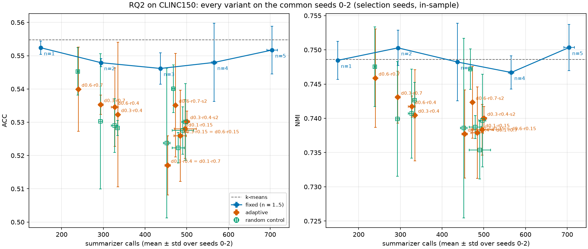

# RQ2 / H2: adaptive summary schedule on CLINC150 with Qwen3-0.6B

## TL;DR

H2 (issue #15): an adaptive schedule matches the default fixed schedule (fixed-n5, 5 summary steps) to within 1 ACC point using at most 50% of its summarizer calls. We swept 11 drift/churn configs (9 distinct schedules) on seeds 0-2, picked `adaptive-d0.6-r0.7` there, and evaluated it on held-out seeds 3-9.

- **Verdict: supported on the mean, not at 95%.** On seeds 3-9, `adaptive-d0.6-r0.7` has ΔACC vs fixed-n5 = -0.007 at 0.33 of fixed-n5's calls, which meets the issue's literal criterion. The 95% t-interval is [-0.017, +0.004], so it does not exclude a loss of more than one ACC point.
- **The pass is hollow.** fixed-n5 is a weak reference on CLINC150: more summary steps do not help. fixed-n1 (150 calls, 21% of fixed-n5) has the best ACC of the fixed family (0.551) and ties k-means (0.551, seeds 0-4). On held-out seeds the adaptive config (235 calls) is significantly worse than fixed-n1, which is cheaper (150 calls): ΔACC -0.028, 95% CI [-0.039, -0.018]. It is also worse than fixed-n2, which costs about 25% more (293 calls): -0.022, [-0.036, -0.007]. A fixed one-summary schedule dominates the adaptive schedule here.
- **The trigger does no better than random selection.** Against a random control that spends the same calls per step, held-out ΔACC is -0.013 (95% CI [-0.032, +0.007]). On seeds 0-2 the per-config deltas range from -0.007 to +0.005. The drift/churn signal is not shown to carry useful information.
- **Practical takeaway:** on this dataset and summarizer, do not use the adaptive schedule; if cost matters, use a single summary step. Whether a stronger summarizer or another dataset changes this is open. All results are one dataset, one 0.6B summarizer, and 3 selection seeds.

## 1. Setup and protocol

- **Dataset:** CLINC150 intent, 22,500 queries, 150 intents. Embeddings: `distilbert` (cached, shared by all methods).
- **Summarizer:** `Qwen/Qwen3-0.6B`, greedy decoding, `max_new_tokens=64`, `batch_size=8`. The prompt is capped at `max_input_tokens=4096` (see Limitations).
- **Loop:** k-means plus summary steps, `tol=1e-4`, 120 Lloyd iterations, `initial_iter` and `final_iter` on. fixed-n splits them into n+1 blocks of 120/(n+1) (fixed-n5: 6 blocks of 20; fixed-n1: 2 blocks of 60). The adaptive and random schedules use fixed-n5's 5 candidate summary steps and 6 blocks of 20, and differ from it only in which clusters are summarized at each candidate step.
- **Cost measure:** summarizer calls (`n_calls` in `metrics.jsonl`), i.e. clusters actually sent to the model. Wall-clock time is too noisy to use (Section 4).
- **Hardware:** one RTX 3060 12 GB under WSL2.
- **Code:** commit `fb6eb01` (worktree used for phases B-D). Phase A ran from `058cd5b`, whose fixed-schedule code path is unchanged.

**Adaptive trigger** (`AdaptiveSchedule`, `src/kslimeans/schedules.py`). At each candidate step, cluster j is re-summarized if it was never summarized, or `drift_j > tau_drift`, or `churn_j > tau_churn`, or (with `s_max` set) it has gone `s_max` candidate steps without a summary. Empty clusters never trigger. Drift is the centroid displacement since the cluster's last summary, in units of its current RMS radius. Churn is the Jaccard distance between its current members and its members at its last summary. Both are measured against a pre-summary anchor taken at summarization time. If no cluster triggers, the step is a plain k-means continuation; if all do, it is a full step; otherwise a partial step re-summarizes only the triggered clusters and the others keep their k-means centers.

**Grid placement.** A pilot (seed 0, fixed-n5, Qwen3-0.6B, CLINC150) gave per-cluster drift medians of 0.06-0.12 RMS radii across summary steps, and churn medians of 0.11-0.22 with 75th percentiles of 0.43-0.68. The grid is tau_drift {0.1, 0.3, 0.6} x tau_churn {0.15, 0.4, 0.7}, plus `s_max=2` at (0.3, 0.4) and (0.6, 0.7): 11 configs.

**Phases** (`configs/rq2_clinc150.yaml`, `scripts/run_rq2.py`):

| Phase | Runs | Seeds |
| --- | --- | --- |
| A | fixed family, `n_summaries` 1-5, plus k-means | 0-4 |
| B | the 11 adaptive configs | 0-2 |
| C | one random control per (adaptive config, seed) | 0-2 |
| D | headline config and its random controls; fixed-n5, fixed-n1, fixed-n2 extended | 3-9 (fixed-n5: 5-9; fixed-n1, fixed-n2: 5-9) |

**Controls.**
- *Default fixed schedule:* fixed-n5.
- *Fixed family at matched calls:* fixed-n1..n5; the adaptive config is compared with the chord between the two fixed-n points bracketing its calls, and with each bracketing point alone.
- *Call-matched random control* (`RandomSubsetSchedule`): at each candidate step it summarizes as many randomly drawn clusters as the adaptive run did on the same seed, drawn among clusters whose membership changed since their last summary (unchanged ones are free cache hits). Only the selection policy differs. Calls match within about 1.3% on every seed in Part 1 of the matched report.

**Headline selection rule.** The adaptive config with the best ACC on seeds 0-2 among those using at most 50% of fixed-n5's calls (otherwise the best ACC among the cheapest third). This picked `adaptive-d0.6-r0.7`. Because it was picked on seeds 0-2, its numbers there are optimistically biased, so the H2 verdict is judged only on held-out seeds 3-9.

**H2 criterion.** fixed-n5 ACC minus adaptive ACC at most 0.01, and adaptive calls at most 50% of fixed-n5's. We additionally report whether the lower end of the 95% t-interval of ΔACC (adaptive minus fixed-n5) stays above -0.01.

## 2. Results

Sources: `rq2_clinc150_table.md` / `.csv` (per-variant means over each variant's own seeds), `rq2_clinc150_matched.md` (paired comparisons), `rq2_clinc150_per_seed.csv` (per-seed rows). Means ± sample std. The `seeds` column matters: rows with different seeds are not directly comparable by eye, and fixed-n5 is lower on seeds 0-9 (0.536) than on seeds 0-2 (0.552).

### 2.1 Selected rows, per-variant means

| Variant | seeds | calls | % of fixed-n5 | ACC | NMI | ARI |
| --- | --- | ---: | ---: | ---: | ---: | ---: |
| k-means | 0-4 | 0 | 0.0% | 0.551 ± 0.007 | 0.748 ± 0.002 | 0.439 ± 0.005 |
| fixed-n1 | 0-9 | 150 ± 0 | 21.3% | 0.551 ± 0.008 | 0.750 ± 0.005 | 0.445 ± 0.008 |
| fixed-n2 | 0-9 | 293 ± 2 | 41.7% | 0.545 ± 0.008 | 0.750 ± 0.005 | 0.443 ± 0.008 |
| fixed-n3 | 0-4 | 437 ± 2 | 62.0% | 0.546 ± 0.007 | 0.748 ± 0.004 | 0.440 ± 0.004 |
| fixed-n4 | 0-4 | 568 ± 6 | 80.6% | 0.545 ± 0.009 | 0.747 ± 0.002 | 0.442 ± 0.008 |
| fixed-n5 | 0-9 | 703 ± 7 | 100.0% | 0.536 ± 0.013 | 0.743 ± 0.006 | 0.435 ± 0.012 |
| adaptive-d0.6-r0.7 | 0-9 | 237 ± 15 | 33.7% | 0.528 ± 0.015 | 0.741 ± 0.006 | 0.424 ± 0.010 |
| random-d0.6-r0.7 | 0-9 | 236 ± 15 | 33.6% | 0.538 ± 0.014 | 0.746 ± 0.007 | 0.432 ± 0.012 |
| adaptive-d0.3-r0.7 | 0-2 | 294 ± 5 | 41.7% | 0.535 ± 0.003 | 0.743 ± 0.004 | 0.422 ± 0.002 |
| random-d0.3-r0.7 | 0-2 | 293 ± 5 | 41.6% | 0.530 ± 0.020 | 0.740 ± 0.008 | 0.420 ± 0.015 |
| adaptive-d0.6-r0.4 | 0-2 | 327 ± 9 | 46.5% | 0.535 ± 0.012 | 0.742 ± 0.002 | 0.426 ± 0.008 |
| adaptive-d0.1-r0.4 (= d0.1-r0.7) | 0-2 | 454 ± 7 | 64.5% | 0.517 ± 0.009 | 0.738 ± 0.006 | 0.415 ± 0.008 |
| adaptive-d0.6-r0.7-s2 | 0-2 | 473 ± 2 | 67.2% | 0.535 ± 0.016 | 0.742 ± 0.005 | 0.426 ± 0.014 |
| random-d0.6-r0.7-s2 | 0-2 | 468 ± 3 | 66.4% | 0.540 ± 0.007 | 0.747 ± 0.003 | 0.435 ± 0.007 |
| adaptive-d0.1-r0.15 | 0-2 | 496 ± 27 | 70.5% | 0.528 ± 0.009 | 0.738 ± 0.004 | 0.421 ± 0.004 |

The full 28-row table (all variants) is in [`rq2_clinc150_table.md`](rq2_clinc150_table.md) and [`rq2_clinc150_table.csv`](rq2_clinc150_table.csv).

The Pareto plot below shows ACC against calls for every variant on seeds 0-2 only. It is in-sample for the adaptive configs and random controls, so the adaptive points are optimistically biased.



### 2.2 Selection seeds 0-2 (in-sample)

Full tables in [`rq2_clinc150_matched.md`](rq2_clinc150_matched.md), Part 1.

- **vs fixed-n5:** all 11 configs have negative mean ΔACC (-0.012 to -0.035). `adaptive-d0.6-r0.7` is the best at -0.012 (sd 0.018; -0.032..+0.002) at 0.34 of fixed-n5's calls. By the per-config rule (ΔACC at least -0.01 and calls at most 50%), no config passes in-sample.
- **vs the call-matched random control:** per-config ΔACC ranges from -0.007 to +0.005 with sds of 0.005-0.030 across 3 seeds. No config is distinguishable from its control. Calls match within 1.3% per seed (all flagged ok).
- **vs the fixed family at matched calls:** every config is below the interpolated fixed family, by -0.010 to -0.029 ACC.

### 2.3 Held-out seeds 3-9 (the H2 verdict)

Config `adaptive-d0.6-r0.7`, chosen on seeds 0-2. Paired seeds 3-9.

| Variant | seeds | calls | % of fixed-n5 | ACC | NMI | ARI |
| --- | --- | ---: | ---: | ---: | ---: | ---: |
| fixed-n5 | 3-9 | 702 ± 4 | 100.0% | 0.529 ± 0.007 | 0.740 ± 0.004 | 0.429 ± 0.007 |
| adaptive-d0.6-r0.7 | 3-9 | 235 ± 19 | 33.5% | 0.522 ± 0.014 | 0.739 ± 0.004 | 0.421 ± 0.008 |
| random-d0.6-r0.7 | 3-9 | 235 ± 19 | 33.5% | 0.535 ± 0.015 | 0.745 ± 0.007 | 0.431 ± 0.014 |

Paired deltas, adaptive minus reference (mean; sd across seeds; 95% t-interval):

| Reference | ΔACC | 95% CI (ACC) | ΔNMI | 95% CI (NMI) |
| --- | ---: | --- | ---: | --- |
| fixed-n5 | -0.007 (sd 0.011) | [-0.017, +0.004] | not reported | not reported |
| call-matched random | -0.013 (sd 0.021) | [-0.032, +0.007] | -0.006 (sd 0.007) | [-0.012, +0.000] |
| interpolated fixed family | -0.024 (sd 0.014) | [-0.037, -0.012] | -0.010 (sd 0.006) | [-0.016, -0.005] |
| fixed-n1 (lower neighbour, 150 calls) | -0.028 (sd 0.012) | [-0.039, -0.018] | -0.011 (sd 0.004) | [-0.015, -0.007] |
| fixed-n2 (upper neighbour, 293 calls) | -0.022 (sd 0.016) | [-0.036, -0.007] | -0.010 (sd 0.007) | [-0.016, -0.003] |

- **H2 by the literal criterion: supported.** ΔACC -0.007 is within 0.01, and 0.33 of the calls is under 0.5.
- **Within one ACC point at 95%: not supported.** The lower end of the interval, -0.017, is not above -0.01. With 7 seeds we cannot rule out a loss of 1.7 points.
- Per-seed ΔACC vs fixed-n5 ranges from -0.028 to +0.010 (matched report); the control's calls deviate by at most 0.4% per seed.
- The bracketing fixed-n points are fixed-n1 and fixed-n2, extended to seeds 5-9; seeds 3-4 come from phase A.

## 3. Interpretation

1. **The H2 pass says more about fixed-n5 than about the adaptive schedule.** fixed-n5 is the default but not a strong reference here. On seeds 0-9 its mean ACC (0.536) is below fixed-n1 (0.551) and fixed-n2 (0.545). On the common seeds 0-4 the family is flat from 2 to 5 summaries (n2 0.545, n3 0.546, n4 0.545, n5 0.544), with fixed-n1 on top at 0.554. Against that reference, nearly any cheap schedule can look close. Against the neighbouring fixed schedules, the adaptive config loses clearly: -0.028 to fixed-n1, which is cheaper, and -0.022 to fixed-n2, which costs about 25% more. Both intervals exclude zero. On this dataset, one summary step costs 150 calls and gets the ACC that 703 calls do not improve on.
2. **The drift/churn trigger is not better than chance.** With calls matched per step, a random choice among changed clusters scores as well or better: held-out ΔACC -0.013 with an interval that includes zero, and on seeds 0-2 deltas of -0.007..+0.005 per config. We cannot claim the trigger is worse than random either. The data are consistent with the trigger picking no better than random clusters, in this setup.
3. **Partial steps seem to cost accuracy relative to full steps at similar calls.** On seeds 0-2, adaptive configs at 454-496 calls score 0.517-0.535 ACC and their random controls at 452-491 calls score 0.522-0.540, while fixed-n3 at 437 calls scores 0.546 (the same on seeds 0-2 and 0-4). The best partial-step config, random-d0.6-r0.7-s2 (0.540 at 468 calls), is still below fixed-n3. This is the same direction for adaptive and random selection, so it does not depend on the trigger. The comparison is also confounded with block structure: fixed-n3 runs 4 blocks of 30 iterations, the partial-step schedules 6 blocks of 20, and the best gap (0.540 vs 0.546) is within one seed sd at n=3. *Hypothesis, untested:* a partial step produces a mixed set of centroids, some placed from summary embeddings and some left at their k-means means, and that mix is worse for the next Lloyd block than all-summary or all-mean centroids. We did not test this; Section 5 lists it as follow-up.
4. **Summary steps raise the k-means objective.** In the 40 adaptive runs' traces (200 summary steps), inertia right after placing summary centroids was above the preceding post-fit inertia every time. Median summary-step inertia was about 19.1k on the first (full, 150-call) step and 12.3k-13.7k on the later partial steps, against 10.7k-10.9k post-fit medians; the next Lloyd block brings inertia back to 10.7k-11.0k. This agrees with the earlier finding from the per-step trace logging (issue #13), where every full summary step raised the objective. It is consistent with summaries moving centroids away from the objective's minimiser, with no systematic ACC gain from doing so more often.

## 4. Observations and quirks

- **Grid collapse: 11 configs are 9 distinct schedules.** Two pairs produced identical schedules: `d0.1-r0.4` = `d0.1-r0.7`, and `d0.3-r0.15` = `d0.6-r0.15`. Per-step `n_calls` and `n_summarized` are identical on every seed, and so is ACC. The only trace differences are float noise around 1e-7 relative in inertia (GPU nondeterminism). With the OR trigger, at tau_drift=0.1 every cluster with churn above 0.4 already had drift above 0.1, and at tau_churn=0.15 every cluster with drift above 0.3 already had churn above 0.15. The report's tables and plot merge these labels; the full table keeps both rows, so identical rows are expected there.
- **Throughput varied and is unexplained.** Per-call throughput ranged from roughly 0.7 to 3 s/call across seeds. It was not output length and not thermal throttling; we did not find the cause. Treat the `s/seed` column as noisy and use calls as the cost measure. Total compute was about 12 GPU-hours (phase A 18:14-22:45 on 2026-10-15; B and C 22:45-04:14; D 04:14-06:03 on 2026-10-16).
- **Seed sensitivity.** fixed-n5 averages 0.552 on seeds 0-2 but 0.536 on seeds 0-9, so the reference moved by 1.6 points depending on seeds. This is why comparisons are paired on common seeds.

## 5. Limitations and next steps

**Limitations**
- **One dataset, one small summarizer.** CLINC150 intents and Qwen3-0.6B only. A stronger summarizer might make summaries more informative and change the picture; the BANKING77 preliminary results (`prelim_bank77.md`) used the same small-model setup.
- **Three selection seeds.** The config was picked on seeds 0-2 with seed-level sds of 0.003-0.022, so the pick may be noise. It is the best of a flat field (in-sample ACC on seeds 0-2 for the four configs under 50% of calls is 0.532-0.540).
- **Held-out n=7.** The interval on ΔACC vs fixed-n5 has half-width 0.011; it cannot resolve effects below about one point.
- **Input truncation.** The summarizer caps a cluster prompt at `max_input_tokens=4096`. `fit_texts_to_budget` keeps the longest fitting leading prefix of the members; if even one text is too long it halves its characters. Its docstring assumes members arrive in k-means++ order (most diverse first), but that ordering is only applied when `force_context_length > 0`. This sweep uses `force_context_length: 0`, so members arrive in ascending dataset index. CLINC150 stores its rows grouped by intent (449 label changes over 22,500 rows), so truncation drops the trailing intent blocks of a mixed cluster, not a random or least-diverse subset. A fix is to order or subsample members before trimming (follow-up). The run logs show 58 truncation warnings over 60 runs. The warning fires once per summarizer instance, so this is a lower bound. In the warned clusters (231-398 members), drops ranged from 1 to 70 texts, at most about 18%; since only the first trimmed cluster per instance is reported, the full range may be wider. It affects all schedules alike, since it is a property of large clusters.
- **Chord interpolation.** The interpolated fixed-family delta uses a straight chord between the bracketing fixed-n points. ACC vs calls is typically concave, so the chord lies below the true curve and the delta can favour the adaptive config. The bracketing-point deltas avoid this and show the same sign. Here the fixed curve is nearly flat, so the effect is small.
- **k-means only on seeds 0-4.** The k-means baseline was not extended to seeds 5-9, so "fixed-n1 ties k-means" is compared on different seed sets (fixed-n1 on seeds 0-4 is 0.554, on 0-9 is 0.551; k-means on 0-4 is 0.551).
- **Random control scope.** Controls were run for all 11 configs on seeds 0-2 but only for the headline config on seeds 3-9.

**Next steps**
- Test the partial-step hypothesis: compare a partial step with the same clusters summarized but all other centroids also replaced by their member-mean embeddings, or measure inertia and ACC after a partial step against a full one at matched calls.
- Repeat with a stronger summarizer than Qwen3-0.6B.
- Run RQ2 on arXiv once #17 lands.
- If an adaptive schedule is still wanted, compare against fixed-n1 and fixed-n2 as the primary references, not fixed-n5.

## 6. Reproducibility

```bash
python scripts/run_rq2.py --dry-run     # plan: runs per phase and which are done
python scripts/run_rq2.py               # all phases A-D, resumable
python scripts/rq2_report.py            # -> docs/results/rq2_clinc150_{table,matched}.md, _per_seed.csv, _pareto.png
```

Use the `summaryCentroids/.venv` Python. Code: commit `fb6eb01`. `results/` is git-ignored; the run directories behind these numbers (`results/<run>/<timestamp>`) are:

- Phase A: `rq2_fixed_n1/20261015-190222`, `rq2_fixed_n2/20261015-192432`, `rq2_fixed_n3/20261015-202121`, `rq2_fixed_n4/20261015-211223`, `rq2_fixed_n5/20261015-181451`
- Phase B: `rq2_adaptive_d0.1_r0.15/20261015-224601`, `rq2_adaptive_d0.1_r0.4/20261015-230432`, `rq2_adaptive_d0.1_r0.7/20261015-232105`, `rq2_adaptive_d0.3_r0.15/20261015-233738`, `rq2_adaptive_d0.3_r0.4/20261015-235505`, `rq2_adaptive_d0.3_r0.7/20261016-000752`, `rq2_adaptive_d0.6_r0.15/20261016-001801`, `rq2_adaptive_d0.6_r0.4/20261016-003528`, `rq2_adaptive_d0.6_r0.7/20261016-004822`, `rq2_adaptive_d0.3_r0.4_s2/20261016-005702`, `rq2_adaptive_d0.6_r0.7_s2/20261016-011539`
- Phase C: `rq2_random_<config>_seed<0-2>/<timestamp>` for each of the 11 configs, timestamps 20261016-013345 to 20261016-040840 (for example `rq2_random_d0.1_r0.15_seed0/20261016-013345`, `rq2_random_d0.6_r0.7_s2_seed2/20261016-040840`)
- Phase D: `rq2_adaptive_d0.6_r0.7_ext/20261016-041452`, `rq2_fixed_n5_ext/20261016-043449`, `rq2_fixed_n1_ext/20261016-051733`, `rq2_fixed_n2_ext/20261016-052630`, `rq2_random_d0.6_r0.7_seed3..9/20261016-054345 to 20261016-060050` (for example `rq2_random_d0.6_r0.7_seed3/20261016-054345`)
