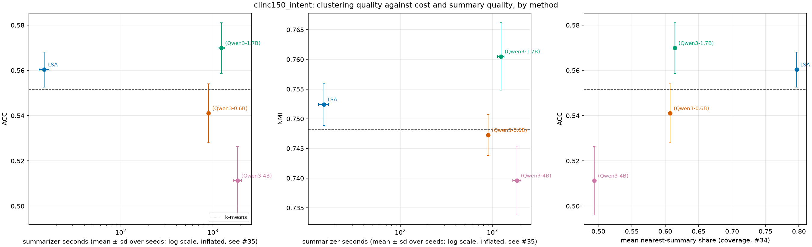
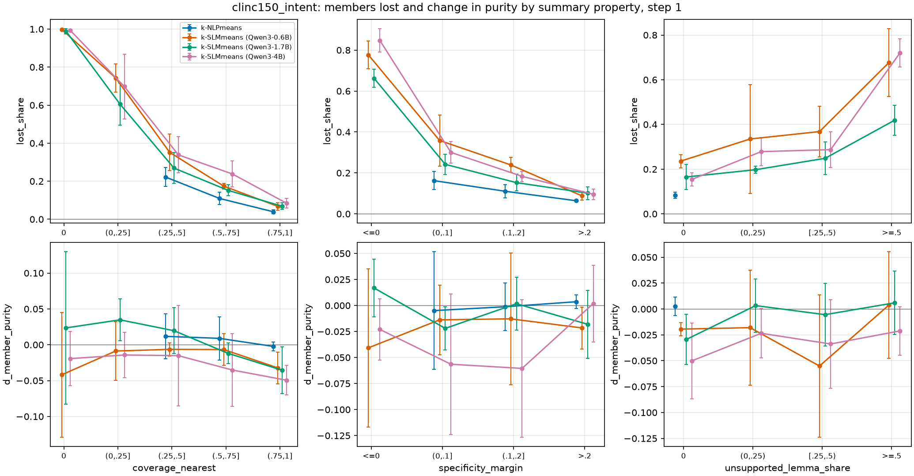
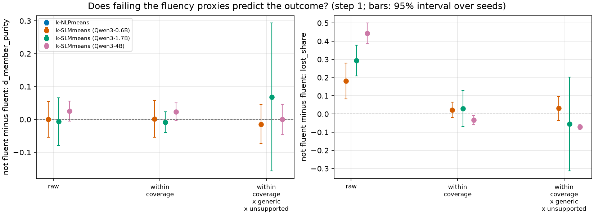
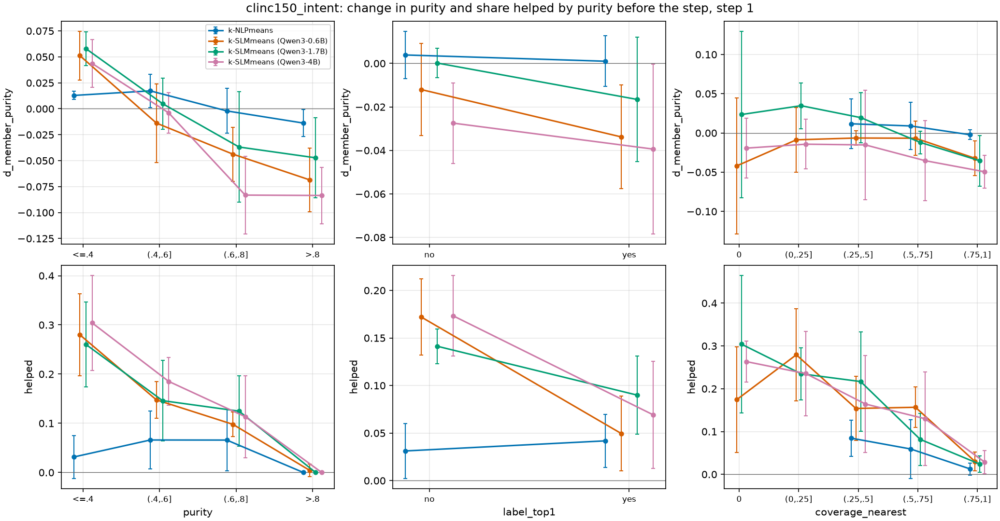

# When do generated summaries help or hurt clustering? Synthesis (issue #50)

Status: **version 3 in progress (Nov 19; Sections 11 to 13 are new and Section 13 is a draft with marked placeholders). Version 2 was the Nov 16 progress report.** One analysis that joins summary quality (#34), centroid replacement (#33), clustering outcome and cost (#35) per cluster and per method. Version 1 was the first cut on the four October runs. This version adds the Qwen3-4B under the clearer prompt (#46) to every table that needs a #33 replay, and the other two clearer-prompt sizes to the method-level table only (they have no #33 replay yet). Sections 2 to 6 and the CSVs are descriptive **associations**. The interventions in the project are #47's swaps (step 1), its guarded run (final scores) and the prompt change of #46 (final scores, two runs), and Section 9 keeps them apart from the rest; Section 10 lists every claim with its scope. Not joined here: BBC (#18, `bbc.md`), arXiv (#48, nothing run) and the Nov 17 review. Version 3 adds the chain from summary quality to the final score (Section 11), the readable-but-poor summaries (Section 12) and a draft answer to the main question (Section 13); Sections 1 to 10 are unchanged.

## 1. What was joined

`scripts/synthesis.py` (module `src/kslimeans/synthesis.py`) writes one row per (dataset, method, seed, summary step, cluster) to `results/synthesis/synthesis_per_cluster.csv` (gitignored, 27,790 rows x 123 columns; regenerate with the command in section 8). Its columns:

| Family | Columns (source) |
| --- | --- |
| Summary quality | nearest-summary share, intent coverage, specificity margin, max cosine to another summary, unsupported-lemma share and flags, the six fluency proxies and `n_flu_flags`, `flag_generic` and its parts (#34) |
| Centroid representation | `drift` (RMS radii), `cosine`, `own_nearest`, `empty_replacement`, `size_replacement`, members out/in at the replacement and at the end of the block, `jaccard_end_vs_pre`, stale-summary flags (#33) |
| Outcome | `purity` before and `purity_after` (#34), `d_purity`, `lost_share`, `gained_share`, the majority intent before and after and whether they agree, `d_jaccard_major`, `member_agree_after` and `d_member_purity` (below), `helped` / `harmed`, each run's final ACC / NMI / ARI and the k-means run of the same seed |
| Cost | `input_tokens`, `output_tokens` of the cluster's prompt and summary, `sent` (False: a memo-cache hit or empty cluster, cost 0), run totals incl. `summarizer_seconds` |

**Indexing and the join.** #34 numbers summary steps from 0 and #33 from 1. Verified on the data: #34 step `j` matches #33 step `j + 1` (a join without the shift matches nothing at step 0 and mismatches everywhere else). The joined `step` is #33's (first summary = 1); `quality_step` keeps #34's. Runs are matched on the config name, never on the method (#34 uses the label, #33 the raw name `k-SLMmeans`, which is shared by the three Qwen runs). The join asserts one-to-one matches in both directions and fails on any unmatched or duplicated key; nothing is dropped silently. Match counts (`synthesis_join_report.csv`):

| Join | Rows | Matched | Left only | Right only |
| --- | ---: | ---: | ---: | ---: |
| #34 x #33 clusters, each of the 5 CLINC150 runs with a #33 replay (the four #31 runs and the v2 4B) | 3,750 | 3,750 | 0 | 0 |
| #34 x #33 clusters, v2 0.6B and v2 1.7B (no #33 replay yet) | 3,750 each | 0 | 3,750 each | 0 |
| #33 clusters x #33 stale flags | 18,750 | 18,750 | 0 | 0 |
| #34 x rebuilt after-block partition (outcome, majority) | 18,750 | 18,750 | 0 | 7,500 |
| #34 x rebuilt cost rows | 27,790 | 27,790 | 0 | 0 |
| #34 x step-1 references (counterfactual, shuffle null) | 3,750 | 3,750 | 0 | 1,500 |
| cluster rows x run metrics (many to one) | 27,790 | 27,790 | 0 | n/a |

The "right only" rows are the logged partitions and step-1 references that the script rebuilds for the two v2 runs without #33 data; they have no cluster rows to attach to and are not used (the join asserts that no #34 row is left without its partner where #33 exists). Nothing is dropped from the #34 side.

The four BANKING77 runs (1,540 rows) and the v2 0.6B and v2 1.7B runs (7,500 rows) have no #33 data and are kept with `has_diag == False`: they enter the method-level table (Section 2) and nothing that needs the replay or an outcome. The majority intent rebuilt from the logs equals #34's `majority_intent` in all 18,750 CLINC150 rows with #33 data (asserted). Cost reconciliation against the logged totals (per seed; checked for the four #31 runs in version 1, not repeated for the v2 runs, whose costs here use the same rebuild): clusters sent equal the logged `n_calls` exactly, input tokens equal `input_tokens` exactly (tokens are rebuilt with the live `hf.fit_and_render` path, tokenizer only), and output tokens plus one EOS per call are within 15 tokens of `output_tokens` per seed, the residual #35 reports.

**Exact versus replayed (#33 section 2).** The #33 columns come from a replay of the logged blocks that starts from the logged summaries re-embedded on the GPU, and that replay is exact: share of clusters where the replayed state agrees with the log (`synthesis_replay_consistency.csv`) is 100% in every cell, for every method and step, both for the replayed pre-replacement cluster having the logged members (steps 2-5) and for the replayed end-of-block size equalling the logged one (steps 1-5). So the replacement-time columns and the `*_end` columns of #33 are exact at every step, not only at step 1. `step1` still marks the step-1 rows; the tables below give **step 1** first and "all steps" as a check. The outcome columns come from the logged partitions at every step, and they, not the `*_end` columns, are the outcomes used here. (The first version of this analysis used CPU-encoded summaries, for which this was not true: the replayed pre-replacement cluster had the logged members in only 33-48% of the 4B's clusters at steps 2-5 and the end-of-block size matched for 48% at step 1, 0.6B 74%; #33 section 2 shows this was encoder noise. In the prose of this note, the only numbers that moved with the GPU embeddings are the step-1 empty-cluster counts and the number of defined step-1 correlations in section 3; in the committed tables the all-steps strata and correlation intervals also moved slightly. No reading changed.)

**Outcome definitions.**

- `lost_share` is the share of the cluster's source members that sit elsewhere after the step's Lloyd block. It measures **disruption**, not damage.
- `d_purity` is `purity_after - purity` for the cluster id. When a cluster loses nearly everyone, the id afterwards holds other documents, so `d_purity` then compares different sets (and is mean-reverting: low-purity clusters have room to rise).
- `d_member_purity` follows the **members**: the share of the cluster's source members whose gold intent is the majority intent of the cluster they end in, minus the cluster's purity before. Weighted by cluster size these sum to the change in overall purity. This is the harm/help outcome used below; `helped` / `harmed` mean `d_member_purity` >= +0.1 / <= -0.1.
- With no no-replacement counterfactual per cluster in #33's file, the changes include what plain Lloyd would have done; LSA (extractive, almost no drift) is the in-table reference.

**Statistics.** The seed is the unit. Every interval is the Student-t interval of per-seed values (stratum means, or Spearman correlations computed within each seed), 4 degrees of freedom with 5 seeds, so intervals are wide on purpose; cells with fewer than 3 seeds (or fewer than 3 clusters per seed and stratum) are blank. Partial correlations regress the ranks of the controls (pre-step purity and log cluster size; for fluency also coverage, margin, unsupported share) out of both ranks. Seeds are paired across methods (every method starts from the same step-0 partition per seed) but each table treats methods separately. No multiple-comparison correction was made: about 120 strata and 480 correlations were computed, so a lone interval that excludes 0 is weak evidence.

## 2. Q4 Method level: quality, ACC and cost



Left and middle: ACC and NMI against summarizer seconds (log scale; mean +/- sd over 5 seeds; same error-bar style as `rq2_clinc150_pareto.png`, k-means dashed). Right: ACC against mean nearest-summary share at the last step. Seconds are inflated (about 1.7x, shared GPU, batch 8/4/1; #35) and are only a rough cost axis; tokens are in the table.

CLINC150, quality at the last summary step (`synthesis_clinc150_intent_methods.csv`; "old" is the #31 prompt, "v2" the clearer prompt of #46):

| Method | nearest-summary share | specificity margin | unsupported share | generic | not fluent | ACC | NMI | dACC vs k-means [95% over seeds] | summarizer s | input / output tokens per seed |
| --- | ---: | ---: | ---: | ---: | ---: | ---: | ---: | ---: | ---: | ---: |
| LSA | 0.796 | 0.250 | 0.000 | 0.00 | 0.01 | 0.560 | 0.752 | +0.009 [0.001, 0.017] | 15 | 0 / 0 |
| old 0.6B | 0.607 | 0.146 | 0.128 | 0.17 | 0.29 | 0.541 | 0.747 | -0.010 [-0.018, -0.002] | 896 | 1.11M / 10.2k |
| old 1.7B | 0.614 | 0.112 | 0.304 | 0.21 | 0.09 | 0.570 | 0.760 | +0.018 [0.004, 0.033] | 1,239 | 1.10M / 18.3k |
| old 4B | 0.494 | 0.003 | 0.454 | 0.47 | 0.35 | 0.511 | 0.740 | -0.040 [-0.058, -0.022] | 1,855 | 1.12M / 15.6k |
| v2 0.6B | 0.689 | 0.204 | 0.013 | 0.06 | 0.39 | 0.563 | 0.755 | +0.011 [0.005, 0.017]* | 373 | 1.12M / 7.8k |
| v2 1.7B | 0.603 | 0.122 | 0.296 | 0.19 | 0.02 | 0.563 | 0.754 | +0.012 [0.005, 0.018]* | 737 | 1.14M / 11.2k |
| v2 4B | 0.672 | 0.153 | 0.141 | 0.17 | 0.43 | 0.568 | 0.760 | +0.016 [0.009, 0.023]* | 1,094 | 1.13M / 9.1k |

\* The v2 runs carry no k-means reference of their own, so the script leaves their dACC blank. These three intervals are copied from `prompt_test.md` Section 8.2 (v2 minus the #31 k-means, paired by seed, same step-0 partitions). Uncorrected 5-seed intervals. Seconds of the v2 runs are not comparable with the old runs' (#46 Section 8.4), and the v2 1.7B's are not a clean timing.

- **Quality does not rank ACC (old prompt).** The 1.7B has the highest ACC and NMI with coverage about equal to the 0.6B's and a lower margin and more unsupported content than the 0.6B; LSA has the best quality scores and a smaller gain. The 4B, worst on coverage, margin, duplicates and unsupported content, is the furthest below k-means (-0.040 ACC [-0.058, -0.022], paired by seed), and the 0.6B is also below it (-0.010 [-0.018, -0.002]). These are uncorrected 5-seed intervals, so the 0.6B's is weak evidence. With four methods this is a description of co-occurrence, not a fit.
- **Under the clearer prompt the quality scores differ a lot and the ACC does not.** The three v2 runs score 0.563, 0.563 and 0.568 ACC (n = 5 seeds each), while their coverage (0.689, 0.603, 0.672), unsupported share (0.013, 0.296, 0.141) and generic share (0.06, 0.19, 0.17) are spread as widely as across the old runs. The v2 1.7B has the lowest coverage and the highest unsupported share of the three and the same ACC. Across all seven model runs ACC spans 0.511 to 0.570, and the only run clearly apart is the old 4B (worst on every quality score). Seven points from two prompts are a description, not a fit.
- **Cost buys nothing monotone.** Every model size sends about 1.1M input tokens per seed (they share a tokenizer); output tokens differ (10k, 18k, 16k). LSA at about 1/60 to 1/120 of the summarizer time has a gain (+0.009 [0.001, 0.017]) that is not distinguishable from the 1.7B's (+0.018 [0.004, 0.033]; both intervals are uncorrected, 5 seeds). The 1.7B's is the only model gain whose interval excludes 0 in the positive direction; the 0.6B and 4B are below k-means.
- BANKING77 (`synthesis_bank77_pareto.png`, approximate partition, no cost columns: those runs predate #30): ACC 0.449 / 0.440 / 0.436 / 0.444 for LSA / 0.6B / 1.7B / 4B against k-means 0.435; paired gains are +0.014 [0.006, 0.022] for LSA and not distinguishable from 0 for the three models (intervals span 0). Quality ranks the same way as on CLINC150 (nearest-summary share 0.80 / 0.74 / 0.68 / 0.68).

### Same model, two prompts: the old and the clearer 4B at step 1

The old 4B (#31) and the v2 4B (#46) start from the same step-0 partition in each seed, so cluster `c` of seed `s` has the same members in both: the 750 step-1 clusters (150 x 5 seeds) are paired. Table: mean over seeds, v2 minus old, with the 95% interval over the 5 seeds and the number of seeds where v2 is higher (`synthesis_prompt_contrast.csv`, from `scripts/synthesis_prompt_contrast.py`). **The prompt changed several things at once** (the task wording, "write only the question", the banned words, #46 Section 8.6), so this is a contrast between two runs, not the effect of one factor, and the v2 summaries are different texts in every cluster.

| Step 1, 750 clusters | old 4B | v2 4B | v2 minus old [95%], seeds higher |
| --- | ---: | ---: | --- |
| duplicate summary | 12.5% | 0.8% | -0.117 [-0.155, -0.080], 0/5 |
| mentions the cluster | 33.5% | 0% | -0.335 [-0.379, -0.290], 0/5 |
| generic flag | 45.5% | 17.7% | -0.277 [-0.341, -0.214], 0/5 |
| unsupported flag | 43.1% | 8.5% | -0.345 [-0.380, -0.311], 0/5 |
| nearest-summary share (coverage) | 0.479 | 0.640 | +0.161 [+0.127, +0.195], 5/5 |
| specificity margin | -0.005 | 0.135 | +0.140 [+0.109, +0.170], 5/5 |
| verbatim copy of a member | 1.9% | 12.4% | +0.105 [+0.066, +0.145], 5/5 |
| no "?" | 11.7% | 38.5% | +0.268 [+0.224, +0.312], 5/5 |
| members lost | 0.435 | 0.236 | -0.199 [-0.239, -0.159], 0/5 |
| `d_member_purity` | -0.032 | -0.009 | +0.023 [+0.007, +0.039], 5/5 |
| helped (>= +0.1) | 14.3% | 10.8% | -0.035 [-0.065, -0.005], 1/5 |
| harmed (<= -0.1) | 15.1% | 10.4% | -0.047 [-0.097, +0.003], 0/5 |
| final ACC (all five steps, #46) | 0.511 | 0.568 | +0.056 [+0.039, +0.074], 5/5 |

- **The summary properties changed in the direction #34 and #46 describe**: no cluster mentions, near-zero duplicates, higher coverage and margin, fewer unsupported flags. Two proxies went the other way: verbatim copies of a member rose from 1.9% to 12.4% (about 93 of the 750 step-1 clusters) and the missing "?" from 11.7% to 38.5% (#34 reads most of those as lowercase questions with the mark dropped).
- **Cluster outcomes moved less than the properties.** Members lost fell by 0.20, but the mean change in members' purity moved from -0.032 to -0.009, and the share of helped clusters went down, not up (14.3% to 10.8%); harmed fell (15.1% to 10.4%, interval touches 0). The sign pattern of Section 5 stays: against the counterfactual the v2 4B raises mixed clusters (purity <= 0.4: +0.034 [0.006, 0.062]; old 4B +0.042) and lowers purer ones ((0.6, 0.8]: -0.047 [-0.079, -0.015]).
- **Where the purity change moved.** "Flagged generic" below is #34's union flag (duplicate, near-duplicate, mentions the cluster, or non-positive margin); #47's duplicate-or-mentions set is a subset of it. In the clusters the old 4B flagged generic (63 to 75 per seed, 341 in all) the member-purity change hardly moved (-0.015 to -0.010, +0.006 [-0.008, 0.019], 3/5) although their members lost fell from 0.75 to 0.34 and their coverage rose from 0.15 to 0.50. In the other 409 clusters it rose from -0.045 to -0.007 (+0.038 [0.010, 0.066], 5/5), and by purity before: > 0.8 -0.084 to -0.035 (+0.048 [0.026, 0.071], 5/5), (0.4, 0.8] -0.036 to -0.013 (+0.023 [-0.003, 0.049]), <= 0.4 +0.044 to +0.035 (-0.008 [-0.028, 0.011]). So most of the gain in this measure is in clusters whose old summaries were not flagged. This does not contradict #47: that experiment measures step-1 ACC after swapping in the 1.7B's text for the flagged clusters (its generic variant of c minus cd also closes 92% of the gap, +0.0244), while this bullet measures the member-purity change after the v2 4B's own text, a different measure on a different intervention. No mechanism is implied. These are descriptive subsets chosen after seeing Section 5; no correction.
- **Verbatim copies.** Copy clusters (93 of 750 at step 1, v2 4B) against the other 657, from the joined file: drift 0.789 against 0.940 RMS radii, cosine to the old center 0.862 against 0.749, coverage 0.781 against 0.620, members lost 0.15 against 0.25. Copying explains little of the change between the two runs: weighting the copy-minus-other gap by the copy share (12.4%) gives about 0.02 of the 0.24 fall in drift and about 0.02 of the +0.16 rise in coverage. Copies also do not look better on purity: the member-purity change is -0.013 for copies against -0.008 for the others, and within the 409 clusters the old 4B did not flag generic -0.014 (62 copies) against -0.007 (347 others). Whether copying contributes to the final ACC gain was not tested.
- **Run-level, v2 0.6B and 1.7B.** Verbatim copies are 33.2% of the v2 0.6B's summaries (14.6% in the old 0.6B), 0.8% of the v2 1.7B's (0.9% old) and 12.0% of the v2 4B's (1.4% old), all steps, from the same #34 scores. The two runs whose ACC rose with the new prompt (0.6B +0.022, 4B +0.056) are the two with more copies, and the one that did not (1.7B, -0.007 [-0.023, +0.010]) is not. Three pairs cannot separate that from the prompt's other changes, and no replay exists for the 0.6B and 1.7B.

## 3. Q1 Harm: which summary properties predict it?

Figure `synthesis_clinc150_intent_harm_strata.png` (step 1; top: lost share, bottom: `d_member_purity`; bars are 95% intervals over seeds). Full tables: `synthesis_clinc150_intent_harm_strata.csv`, `synthesis_clinc150_intent_correlations.csv`, `synthesis_tables.md`.



Step 1, mean over seeds (Qwen3-0.6B / 1.7B / 4B; LSA in brackets where defined):

| Cluster set | lost share | d_member_purity |
| --- | --- | --- |
| all clusters | 0.31 / 0.26 / 0.44 (LSA 0.08) | -0.020 / -0.006 / -0.032 (LSA +0.003) |
| nearest-summary share (0, .25] | 0.74 / 0.60 / 0.70 | -0.009 / +0.035 / -0.014 |
| nearest-summary share (.75, 1] | 0.07 / 0.07 / 0.09 | -0.032 / -0.035 / -0.049 |
| specificity margin <= 0 | 0.78 / 0.66 / 0.85 | -0.041 / +0.017 / -0.023 |
| specificity margin > .2 | 0.09 / 0.10 / 0.10 | -0.022 / -0.018 / +0.002 |
| generic flag, yes | 0.73 / 0.58 / 0.75 | -0.030 / +0.018 / -0.015 |
| generic flag, no | 0.20 / 0.16 / 0.17 | -0.017 / -0.013 / -0.045 |

- **Members lost track the summary properties closely.** Rank correlation with `lost_share` at step 1 (mean over seeds): nearest-summary share -0.78 / -0.72 / -0.83 (0.6B / 1.7B / 4B), specificity margin -0.63 / -0.51 / -0.77, generic flag +0.50 / +0.42 / +0.66, unsupported share +0.31 / +0.27 / +0.63, cosine between pre-center and summary -0.63 / -0.51 / -0.75; all intervals exclude 0 and survive partialling out purity and size (e.g. coverage -0.73 / -0.64 / -0.80). **This is largely built in**: the nearest-summary share is the share of members whose nearest summary is this cluster's, so members lost at the replacement is roughly one minus it; margin, drift and the generic flag are the same geometry again. Exact-duplicate summaries (the 4B has 94 of 750 clusters at step 1) lose 99.8% of their members by construction. The disruption is real, but it is evidence that the scores measure what they say, not an independent finding about harm.
- **Change in purity is not predicted by them.** `d_member_purity` against every quality property, partialling out purity and size, step 1: all rank correlations lie between -0.13 and +0.15 and all but a few intervals include 0 (coverage -0.02 to +0.08, margin +0.04 to +0.13, unsupported share -0.06 to +0.03, generic flag -0.11 to +0.06); with all steps pooled the same holds (all |rho| <= 0.09). Five of the 64 step-1 intervals (55 are defined) exclude 0: 0.6B specificity margin +0.127 and own-nearest +0.152, 1.7B intent coverage -0.130, 4B specificity margin +0.061 and duplicate flag +0.085. The signs are mixed (margin, own-nearest and duplicates point the "worse summary, better purity" way; the intent-coverage one the other way), the largest is 0.15, and about 3 of the 55 defined intervals (2.8) are expected by chance at the 5% level, so this is not a pattern. Without controlling for pre-step purity, `d_purity` correlates positively with the unsupported share and the generic flag (+0.05 to +0.22): those clusters are the low-purity ones, which gain on average.
- **What does predict the sign of the purity change is the purity before the step** (Q3 below): high-purity clusters lose purity, low-purity ones gain, for every Qwen model, far more than any summary property separates them.
- **Representation columns.** Own-nearest "no" (the summary is nearer another cluster's old center): lost share 0.78 / 0.67 / 0.84 against 0.21 / 0.17 / 0.19 for "yes". Drift above 1.5 RMS radii: 0.90 / 0.75 / 0.93 lost. `empty_replacement` is rare except for the 4B (6 / 3 / 54 of 750 clusters for the 0.6B / 1.7B / 4B at step 1). None of the representation columns predicts `d_member_purity` once purity and size are controlled (|rho| <= 0.15).
- **Summary of Q1.** The properties predict which members move, strongly and mostly by construction; they do not, in this data, predict whether the move improves or worsens the cluster's purity. A worse overall result appears at the method level (4B ACC -0.040, 0.6B -0.010), and the step-1 mean cluster `d_member_purity` is also negative for those two (-0.032 and -0.020, against LSA +0.003). These are different quantities (step-1 cluster means of a purity change against the final run's ACC after five steps) and are listed side by side, not linked; the cluster-level properties above do not explain the purity change, and what links a method's worse summaries to its worse ACC is not shown here (n = 4 methods; causes are #47's).
- **The v2 4B (added).** The same picture at step 1: the rank correlation of members lost with nearest-summary share is -0.75 [-0.77, -0.74], with specificity margin -0.50 [-0.54, -0.46] and with the generic flag +0.40 [+0.33, +0.47] (mean over 5 seeds, interval over seeds). `d_member_purity` against 16 summary and geometry properties, partialling out purity and size, lies between -0.06 and +0.10, and all 16 intervals include 0. Its step-1 empty clusters are 2 of 750 (old 4B 54).

## 4. Q2 Fluency



Failing the fluency proxies is associated with large losses of members in the raw data, but not once coverage is accounted for.

| Outcome, step 1 | adjustment | 0.6B | 1.7B | 4B |
| --- | --- | ---: | ---: | ---: |
| lost share, not fluent minus fluent | raw | +0.18 [0.08, 0.28] | +0.29 [0.21, 0.38] | +0.44 [0.39, 0.50] |
| | within nearest-summary-share strata | +0.02 [-0.02, 0.06] | +0.03 [-0.07, 0.13] | -0.03 [-0.06, -0.01] |
| | within coverage x generic x unsupported strata | +0.03 [-0.04, 0.10] | -0.06 [-0.31, 0.20] | -0.07 [-0.08, -0.06] |
| d_member_purity, not fluent minus fluent | raw | +0.001 [-0.054, 0.055] | -0.006 [-0.079, 0.066] | +0.025 [-0.005, 0.056] |
| | within coverage strata | +0.002 [-0.054, 0.058] | -0.008 [-0.040, 0.024] | +0.024 [-0.003, 0.050] |
| | within coverage x generic x unsupported | -0.014 [-0.074, 0.045] | +0.068 [-0.157, 0.293] | 0.000 [-0.047, 0.047] |

- The raw gap in lost share (0.18 to 0.44) is almost entirely the lower coverage of the summaries that fail a proxy; the 4B's fluency failures are the prompt echoes, quotes and missing "?" that go with its duplicate and "main theme of the cluster" summaries (#34). Within coverage strata the gap is 0.02 to 0.03 for the 0.6B and 1.7B (intervals include 0) and slightly negative for the 4B (-0.03 [-0.06, -0.01], and -0.07 with the finer strata: not fluent summaries lose a little fewer members at equal coverage).
- Partial rank correlation of the number of failed proxies with `d_member_purity`, controlling for coverage, margin, unsupported share, purity and size: +0.06 / +0.01 / -0.02 / -0.01 (LSA / 0.6B / 1.7B / 4B), all intervals include 0; with lost share: +0.03 / +0.05 / +0.11 / -0.02, also including 0 (1.7B [-0.00, 0.23]). All-steps pooling gives the same picture.
- So in this data fluency does not predict the outcome beyond coverage and genericity, as the professor's point suggests. The proxies are cheap surface checks (#34), and the 0.6B and 1.7B have few strata with both groups at step 1; the 1.7B's wide intervals reflect that.

## 5. Q3 When do summaries help?



At step 1, 12.7% / 12.3% / 14.3% of the 0.6B / 1.7B / 4B clusters are `helped` (member purity up by at least 0.1) and 12.7% / 9.6% / 15.1% `harmed` (LSA 3.6% / 2.5%). Helped and harmed are about equally common.

**Two references.** The cluster-level change in members' purity has no meaning on its own: part of any change is what the same data would do anyway, and "purity before" is a maximum over the cluster's own members, so members tend to agree less with the majority of wherever they land than with the majority they came from, whatever moved them (plurality-selection asymmetry). So the change is compared with two references, both at step 1 (`synthesis_clinc150_intent_help_reference.csv`, figure `synthesis_clinc150_intent_help_reference.png`):

- **No-replacement counterfactual** (#33's): plain Lloyd for the same 20 iterations from the exact step-0 state (`kslimeans.replay`; step 0 replays the logged partition exactly for every run and seed, asserted). It does not depend on any summary or embedding. It is the same for every method of a seed and barely moves anything: the share of members lost is 0.012 and the mean `d_member_purity` +0.001 [-0.001, 0.002] (helped 0.4%, harmed 0.3%). So the purity changes below are not "what Lloyd would have done anyway"; they are produced by the replacement step plus the Lloyd block it starts. It is not dose-matched: it moves 1% of members, the summaries 26-44%.
- **Random-shuffle null**: each cluster's members are moved at the cluster's own logged loss (its `lost_share`) to uniformly random other clusters (mean of 20 draws per cluster and seed). It is dose-matched and includes the plurality asymmetry: the mean `d_member_purity` is -0.12 (1.7B), -0.15 (0.6B), -0.22 (4B), and -0.04 for LSA, and negative in every purity stratum.

Step 1, mean over seeds [95% interval over seeds] of the summary step's `d_member_purity` minus each reference (all strata, including LSA, in `synthesis_tables.md`):

| Purity before | LSA minus counterfactual | 0.6B | 1.7B | 4B | 0.6B minus null | 1.7B minus null | 4B minus null |
| --- | ---: | ---: | ---: | ---: | ---: | ---: | ---: |
| all (750) | +0.002 | -0.021 [-0.037, -0.005] | -0.007 [-0.018, 0.005] | -0.032 [-0.046, -0.019] | +0.131 | +0.114 | +0.188 |
| <= 0.4 (187) | +0.012 [0.007, 0.016] | +0.050 [0.024, 0.076] | +0.057 [0.039, 0.074] | +0.042 [0.018, 0.067] | +0.182 | +0.184 | +0.214 |
| (0.4, 0.6] (192) | +0.013 [0.003, 0.024] | -0.018 | +0.001 | -0.008 | +0.161 | +0.146 | +0.213 |
| (0.6, 0.8] (133) | -0.003 | -0.044 [-0.070, -0.019] | -0.038 | -0.084 [-0.120, -0.047] | +0.119 | +0.100 | +0.220 |
| (0.8, 0.9] (69) | -0.000 | -0.084 [-0.145, -0.023] | -0.072 | -0.058 | +0.155 | +0.060 | +0.262 |
| > 0.9 (169, 22.5%) | -0.017 | -0.060 [-0.103, -0.018] | -0.036 [-0.056, -0.016] | -0.090 [-0.137, -0.042] | +0.034 | +0.031 | +0.074 |

(Intervals are given where they exclude 0 or matter; see the CSV for all. The "minus null" intervals exclude 0 in all rows except the three smallest-effect ones for the 0.6B and 1.7B at > 0.9 and 1.7B at (0.8, 0.9].)

- **Against random moves, the summaries' moves are better in every stratum** (+0.03 to +0.26), as expected of moves that follow embedding geometry; this is the dose-matched evidence that the movement is not random, in line with #33's movers table (toward-gold moves 24-31 times shuffled).
- **Against doing nothing (the counterfactual), the sign pattern holds**: the replacement raises member purity of mixed clusters (purity <= 0.4: +0.04 to +0.06 for the three models, intervals excluding 0, helped 26-30% against 0% for the counterfactual) and lowers it for pure ones (purity > 0.9: -0.04 to -0.09; (0.6, 0.8]: -0.04 to -0.08). LSA, which loses about 8% of members, shows the same sign pattern at a fraction of the size (+0.012 at <= 0.4, -0.017 at > 0.9), so it is a dose-response, not a property of the neural summaries; LSA is not dose-matched to the others and no dose-matched statement is made.
- **Ceiling.** Clusters with purity above 0.9 are 22.5% of the step-1 clusters and cannot be helped by +0.1 (purity cannot exceed 1), so their `helped = 0` cells are mechanical, and only "harmed" is informative there. The same applies, to a lesser extent, to (0.8, 0.9].
- **Size.** `d_member_purity` correlates with cluster size at step 1 (Spearman +0.13 LSA, +0.23 / +0.25 / +0.19 for the 0.6B / 1.7B / 4B; +0.05 to +0.15 after controlling for purity), because small clusters' purity before is inflated. Stratifying purity by size (<= 150, > 150 members; `purity_x_size` in the CSV) shows that the loss in the middle and upper purity strata is concentrated in small clusters: for purity (0.6, 0.8] the change minus the counterfactual is -0.09 / -0.11 / -0.145 for the small clusters and +0.00 / +0.02 / -0.03 for the large ones (0.6B / 1.7B / 4B), while the gain at purity <= 0.4 is larger in the large clusters (+0.06 / +0.07 / +0.05 against +0.04 / +0.04 / +0.04). Cells with fewer than 3 seeds contributing are blank (> 0.9 large clusters).
- **The `label_top1` association is not an explanation.** The summary being nearest to its cluster's majority-intent name goes with fewer helped clusters (0.05 / 0.09 / 0.07 against 0.17 / 0.14 / 0.17) and less lost share, but purity is not controlled in that comparison, and such clusters are the already-good ones. It was not tested whether the summary naming the intent matters at a given starting purity.
- **The v2 4B (added), step 1:** member-purity change minus the no-replacement counterfactual -0.009 [-0.023, +0.005] (old 4B -0.032 [-0.046, -0.019]), 10.8% helped and 10.4% harmed; by purity before, <= 0.4 +0.034 [+0.006, +0.062], (0.6, 0.8] -0.047 [-0.079, -0.015], > 0.9 -0.026 [-0.071, +0.019]; minus the shuffle null +0.103 (+0.188 old). The sign pattern is the same as for the three old models and smaller than the old 4B's, in a dose-matched sense: it loses 0.24 of its members against 0.44.
- **Not done.** The question as posed in #50, whether the summary pulls the centroid toward a gold intent that k-means had split or merged, needs split and merge detection (which gold intents are spread over several clusters, which clusters merge several), and that is not in this first cut. What is shown is where purity rises and falls, not that a rise is a repaired split or merge. `d_jaccard_major` (overlap with the cluster's majority intent) is in the joined CSV for it.

## 6. Q5 Datasets

- **CLINC150**: sections 2 to 5.
- **BANKING77 (approximate)**. Only the last summary step is scored, against the FINAL partition (#34's caveat), so there is no outcome for the step, no #33 columns and no per-cluster cost rebuilt from logged data (the join carries rebuilt input tokens flagged `cost_approx`, which assume every non-empty cluster was sent). `synthesis_bank77_cross_section.csv`: cross-sectional rank correlation of the properties with the cluster's purity in the final partition (mean over seeds). Nearest-summary share +0.43 / +0.52 / +0.47 / +0.56 (LSA / 0.6B / 1.7B / 4B), specificity margin +0.45 / +0.52 / +0.32 / +0.43, max cosine to another summary -0.47 / -0.31 / -0.40 / -0.39, unsupported share 0.00 / -0.18 / -0.16 / -0.10; the correlations of coverage and margin with purity are similar in size for LSA and the three models, and partialling out cluster size shrinks them but not to 0 (coverage +0.38 to +0.47). Fluency proxies: -0.06 to +0.10 and mostly intervals including 0. This says that good-covering, specific summaries sit on pure clusters, which is partly circular (a pure cluster has a mean that a summary can sit near) and cannot tell harm from help.
- **Prompt v2 (#46):** the 4B is in every table; the 0.6B and 1.7B are in the method-level table only, until they have a #33 replay (the script treats them like BANKING77 for that, and Section 1 says what that means for the join).
- **BBC (#18):** not joined here. It has its own write-up (`bbc.md`), five seeds, 500 articles and k = 5, which is too few clusters per seed for this per-cluster analysis. Its reading is in Section 9.
- **arXiv (#48):** nothing has run at scale (`arxiv_status.md`); nothing here. To add a dataset, pass its run directories, its #34 per-cluster CSV and a #33 file that covers it to `scripts/synthesis.py`; runs absent from #33 are treated like BANKING77. Methods with the same label from different configs get `[config]` appended to the method id.

## 7. Limits

- One model family (Qwen3), two prompts on CLINC150 (old and clearer, #46) and one on BANKING77, 5 seeds (intervals have 4 degrees of freedom; a stratum that is empty in a seed drops that seed). BBC has 5 seeds, 500 articles and 5 clusters.
- Replayed blocks and summary embeddings: the #33 columns (`drift`, `cosine`, `own_nearest`, `empty_replacement`, the `*_end` columns) use summary embeddings re-computed on the GPU and replayed blocks. The replay equals the logged blocks in every cluster at every step (also for the v2 4B), so these columns are not noisy because of the replay. They do rest on one encode: a re-encode that differs at the 1e-6 level changes up to about 9% of the old 4B's labels after a block (#33 section 2), so the old 4B's geometry strata are not robust to that. The noise-floor probe was not run for the v2 4B. Quality and outcome columns come from the logged partitions and are not affected; the step-1 no-replacement counterfactual does not use summary embeddings and is exact.
- Associations in observational per-cluster data; summary quality, geometry and member loss are mechanically related (section 3). `d_member_purity` is purity against gold labels, one view of "better"; ACC/NMI/ARI are only available per run.
- "Same model, two prompts" is a contrast of two runs whose prompts differ in several ways and whose summaries differ in every cluster. Its subsets (by the old run's flag, by purity) were chosen after seeing the tables above, and no correction was made for them.
- The v2 0.6B and v2 1.7B have no #33 replay and appear only at the method level. The v2 runs have no k-means reference of their own in the joined data, so their dACC is quoted from `prompt_test.md`. The seconds of the v2 runs are not comparable with the old runs' and the v2 1.7B timing is not clean (#46 Section 8.4).
- Per-cluster cost is tokens only: the logs have one timed `summarize_batch` call per step, so seconds per summary exist only as run totals (inflated, #35). Per-cluster tokens mostly follow cluster size; cost was not analysed per cluster beyond the method level.
- No multiplicity correction; no hand check of #34's scores yet (pending), so the unsupported and generic flags carry their own known looseness, and the "?" and verbatim-copy proxies are the ones the v2 summaries trip most.
- Version 2 regenerated every committed `synthesis_*` table. The rows of the four October runs are unchanged except in the correlations of drift and cosine over all steps, where 35 (rho), 44 (lower bound) and 43 (upper bound) of 768 values moved by more than 1e-6, by at most 7.4e-5, and no interval changed whether it includes 0; the #33 per-cluster file was recomputed for this run, and the differences are float rounding in the replay. Counts, strata, methods and the help tables are identical to the printed digits.
- Section 9 is the reading of all the evidence at this date. It will change with the Nov 17 review and the remaining runs (seeds 5-9, #33 for the other v2 sizes, arXiv).

## 8. Reproduce

```bash
export HF_HUB_OFFLINE=1 CUDA_VISIBLE_DEVICES=""; R=../k-slimeans/results   # the logged runs, #33 files and cache
OLD="$R/clinc150_lsa/20261027-174631 $R/clinc150_qwen3-0.6b/20261027-190908 $R/clinc150_qwen3-1.7b/20261027-202532 $R/clinc150_qwen3-4b/20261027-221042"
V2="$R/clinc150_v2_qwen3-4b/20261112-181256 $R/clinc150_v2_qwen3-0.6b/20261112-200926 $R/clinc150_v2_qwen3-1.7b/20261112-204127"
python scripts/summary_quality.py $OLD $V2 $R/prelim_bank77_*/* \
    --cache-dir ../k-slimeans/cache --out-dir results/summary_quality          # #34, about 12 min with the v2 runs
# the #33 per-cluster files must come from the GPU-embedding replay (replacement_diagnostic.md section 10):
#   python scripts/embed_logged_summaries.py $OLD --cache-dir ../k-slimeans/cache --out $R/replacement_diagnostic/summary_embeddings_cuda.npz --device cuda
#   python scripts/embed_logged_summaries.py $R/clinc150_v2_qwen3-4b/20261112-181256 --cache-dir ../k-slimeans/cache \
#       --out $R/v2_embed/summary_embeddings_cuda_v2_4b.npz --device cuda
#   python scripts/replacement_diagnostic.py $OLD $R/clinc150_v2_qwen3-4b/20261112-181256 --cache-dir ../k-slimeans/cache \
#       --summary-embeddings $R/replacement_diagnostic/summary_embeddings_cuda.npz $R/v2_embed/summary_embeddings_cuda_v2_4b.npz \
#       --out-dir <scratch dir> --work-dir $R/v2_diag   # writes replacement_diagnostic_{clusters,stale}.csv to $R/v2_diag
python scripts/synthesis.py $OLD $V2 $R/prelim_bank77_*/* --cache-dir ../k-slimeans/cache \
    --quality-clusters results/summary_quality/summary_quality_per_cluster.csv \
    --diag-clusters $R/v2_diag/replacement_diagnostic_clusters.csv \
    --diag-stale $R/v2_diag/replacement_diagnostic_stale.csv --out-dir docs/results \
    --joined-csv results/synthesis/synthesis_per_cluster.csv          # about 3 min on 2 threads
python scripts/synthesis_prompt_contrast.py results/synthesis/synthesis_per_cluster.csv --out docs/results/synthesis_prompt_contrast.csv
python scripts/synthesis_chain.py results/synthesis/synthesis_per_cluster.csv --out-dir docs/results          # Sections 11 and 12
HF_HUB_OFFLINE=1 python scripts/synthesis_chain_examples.py $R/clinc150_v2_qwen3-4b/20261112-181256 \
    results/synthesis/synthesis_per_cluster.csv --cache-dir ../k-slimeans/cache > docs/results/synthesis_chain_examples.txt
python -m pytest tests/test_synthesis.py tests/test_synthesis_chain.py -q
```

The two v2 runs without a #33 file are accepted as they are: the script joins them to #34 and cost only, and the join report lists their 3,750 rows each as left only. Leave them out of the run list to reproduce version 1 plus the v2 4B. With the CPU-encoded fallback (`summary_embeddings_cpu.npz`) the commands run, but `synthesis_replay_consistency.csv` is no longer 1.000 (the old 4B's replayed blocks differ from the logs), and the step >= 2 and geometry columns for the old 4B carry that noise.

CPU only (the scripts hide the GPU; tokenizers load from the local cache). Outputs: `synthesis_tables.md` (all tables), `synthesis_join_report.csv`, `synthesis_replay_consistency.csv`, `synthesis_prompt_contrast.csv`, `synthesis_<dataset>_{methods,harm_strata,help_strata,help_reference,correlations,size_corr,fluency,fluency_partial,cross_section}.csv`, and the figures `synthesis_<dataset>_{pareto,harm_strata,help_strata,help_reference,fluency}.png`.

## 9. What the evidence so far suggests about when summaries help or hurt (preliminary)

All numbers are CLINC150, 5 seeds, Qwen3, unless a bullet says otherwise. "Interventional" means the summary text or its use was changed by the experimenter; everything else is an association between logged properties and outcomes.

**What a summary does to a cluster (associations, #33 and #34).**

- **Members move in proportion to coverage, and this is built in.** At step 1 the share of a cluster's members lost correlates with nearest-summary share at -0.78 / -0.72 / -0.83 (old 0.6B / 1.7B / 4B) and -0.75 (v2 4B). It is largely a restatement of what the score measures (Section 3).
- **Where members move, purity changes are not predicted by the summary scores.** Step-1 change in member purity minus plain Lloyd: mixed clusters (purity <= 0.4) +0.04 to +0.06 for the three old models and +0.034 for the v2 4B; pure ones lose (purity > 0.9: -0.04 to -0.09 old, -0.026 v2 4B, interval includes 0). With purity and size controlled, for the old models 5 of the 55 defined step-1 partial intervals exclude 0, with mixed signs and rho within -0.13 to +0.15 (Section 3), and for the v2 4B all 16 include 0 (rho -0.06 to +0.10); the starting purity is what separates the signs, and fluency adds nothing beyond coverage (Section 4).
- **Old 4B: duplicate collapse (#33, exact replay, 30 of 30 fits per run).** At step 1 it has 18.8 duplicate summaries per seed (1.7B 0.8, v2 4B 1.2) and 10.8 emptied clusters after the replacement (0.6 and 0.4), and its logged step-1 partition is below plain Lloyd in ACC in 5 of 5 seeds (-0.0159; 1.7B +0.0106, 0 of 5 below; v2 4B +0.0024, 2 of 5 below). These are measurements of the run, not of why its final scores are low.

**Where the evidence is interventional (#47, one model pair, one dataset).**

- **Stage 1, step 1 only: the 1.7B's summaries in the flagged clusters close the gap.** Putting the 1.7B's summaries into the 4B's flagged clusters (43 to 56 of 150 per seed, those that duplicate another or mention the cluster) raises the step-1 ACC by +0.026 [+0.019, +0.034], 5 of 5 seeds, which is 99% of the 4B-to-1.7B gap (+0.0265). The same swap into the same number of random unflagged clusters changes it by -0.002 [-0.012, +0.007]; the difference is +0.0285 [+0.0149, +0.0420]. The reverse (4B flagged summaries into the 1.7B) costs -0.025 [-0.041, -0.009] against the matched control. Flagged clusters may also be harder clusters, and only step 1 was tested.
- **Stage 2, all five steps: removing the flagged summaries' influence does not recover the final score.** Starting flagged clusters from their k-means center at every step moves the 4B's final ACC by +0.009 [-0.006, +0.024] (4 of 5 seeds higher), NMI +0.001 [-0.007, +0.009], ARI -0.007 [-0.019, +0.006]; it stays 0.031 ACC below k-means (0 of 5 seeds). An effect of up to +0.024 is not excluded. The guard replaces a summary with no summary, not with a better one, and acts on a third of the clusters, so it does not test the stage-1 swap over five steps.
- **Both together:** at step 1, the flagged summaries differ from the 1.7B's in a way that matters for ACC; whether that carries through to the 4B's final deficit is not shown.

**The clearer prompt (#46 and the same-model contrast, Section 2).**

- **It removes the old 4B's drop and lifts the 0.6B.** Final ACC v2 minus old, paired by seed: 4B +0.056 [+0.039, +0.074] (5 of 5 seeds; 0.568 against 0.511, now above k-means by +0.016 [+0.009, +0.023]), 0.6B +0.022 [+0.010, +0.033] (5 of 5), 1.7B -0.007 [-0.023, +0.010] (1 of 5).
- **No size order remains.** v2 means 0.563 / 0.563 / 0.568 (0.6B / 1.7B / 4B), and all paired ACC intervals between sizes include 0; the old order (1.7B > 0.6B > 4B, differences 0.029 to 0.059) is gone. So the October size comparison on CLINC150 depended on the prompt. The prompt changed several things at once, so this does not isolate the cluster-mentioning failure, and the 4B's change in the intervention above (a swap of flagged summaries) is a different test.
- **Between the two 4B runs the summary properties changed far more than the cluster outcomes.** Mentions 33.5% to 0%, duplicates 12.5% to 0.8%, coverage 0.48 to 0.64, members lost 0.44 to 0.24; but the mean member-purity change at step 1 moved only from -0.032 to -0.009 (+0.023 [+0.007, +0.039]) and the share of helped clusters fell from 14.3% to 10.8%.

**Quality scores and the verbatim-copy caveat (#34).**

- Across the seven CLINC150 model runs the quality scores (coverage 0.49 to 0.69, unsupported share 0.01 to 0.45) do not rank ACC (0.511 to 0.570); the old 4B is worst on coverage, margin, unsupported share and the generic flag and also lowest in ACC, and the v2 runs, with very different scores, share an ACC (0.563 to 0.568).
- The clearer prompt raises the share of summaries that copy a cluster member word for word: 12% of the v2 4B's (451 of 3,750), 33% of the v2 0.6B's, 0.8% of the v2 1.7B's (old: 1.4%, 14.6%, 0.9%). Copies have no unsupported words by construction and a higher coverage (0.78 against 0.62 in the v2 4B at step 1), and a copied member makes the summary embedding a member embedding. In the v2 4B, though, copying accounts for only about 0.02 of the +0.16 coverage gain and 0.02 of the 0.24 drop in drift, and copies do not look better on purity (-0.013 against -0.008), so it does not explain much of the change between the runs. The two runs that gained most from the prompt are the two with the most copies; the 1.7B has few and did not gain. Three runs; the ACC link is not tested, no replay for the 0.6B or 1.7B.

**BBC (#18; 500 articles, k = 5, 5 seeds, `bbc.md`).**

- In the TF-IDF space the mean ACC is k-means 0.788, LSA 0.839, 0.6B 0.851, 4B 0.854, 1.7B 0.873, so every summary method is above k-means, but 2 of the 30 paired intervals exclude 0 (1.7B against k-means in ARI, +0.125 [+0.007, +0.243]; 1.7B against LSA in NMI) and the seed spread (0.02 to 0.08) is as large as the gaps. Size does not order the models.
- In the dense (MiniLM) space the means (k-means 0.866, LSA 0.897, 0.6B 0.960, 1.7B 0.904, 4B 0.902) are carried by seeds 0 and 2, whose shared step-0 partition merges two topics; on the other three seeds all methods are within 0.008 of each other, and the 0.6B's lead is one seed's outcome (seed 0).
- BBC has no cluster-level join here; it shows that no summary-based method is detectably worse than k-means on this dataset (5 seeds), not why.

**What this adds up to.** On CLINC150 a summary changes which members a cluster keeps in proportion to how well it covers them; whether that helps depends on the cluster's starting purity and is not predicted by the quality scores. The 4B's low final ACC under the old prompt went with duplicate and cluster-mentioning summaries; at step 1, replacing those summaries with a better model's closes the gap to that model, while removing them from all five steps does not recover the final score. A clearer prompt removes the 4B's drop and the size order together, with its quality scores rising but with more copied members, which this analysis cannot separate from the better wording. That is the reading these data support. It rests on one model family, one dataset for the cluster-level analysis, five seeds, and, apart from #47's swaps, no isolated factor: the prompt change is an experimenter-changed input on the same seeds and step-0 partitions, an uncontrolled two-run intervention that altered several things at once, and everything else is association.

## 10. Claims and their scope (#81)

Every claim the replacement experiments are used for, with where its evidence is, whether it comes from an intervention or from logged associations, and exactly what it covers. "Step 1" is the first summary step and its Lloyd block; "final" is the score after all five steps. All rows are CLINC150 with the encoder of the runs and 5 seeds unless the scope says otherwise; intervals are uncorrected t-intervals over seeds. Status: shown (the evidence supports the claim as scoped), not shown (the experiment that would show it was run and does not), inconclusive (the interval is too wide to say).

| Claim | Evidence | Kind | Scope | Status |
| --- | --- | --- | --- | --- |
| Replacing the centers by summary embeddings raises the k-means objective J at fixed assignments, by the size-weighted squared movement of the centers (an identity, not a measurement) | `replacement_diagnostic.md` section 3, `replacement_objective_identity.csv` | identity, checked numerically | step 1; 25 replays (LSA, three old Qwen3 sizes, v2 4B); max relative residual 2.9e-16 | shown |
| The rise in J is large (+70% to +98% after reassignment) and Lloyd removes most of it within one or two iterations | `replacement_diagnostic.md` section 3 | measurement of logged runs | step 1 (iteration shares over all steps); 5 methods; 5 seeds | shown |
| The objective after the block says nothing about the outcome: the 1.7B and the old 4B rise about equally and both end above the no-replacement run in J, but on opposite sides in ACC | `replacement_diagnostic.md` sections 3 and 6 | association | step 1; two models; 5 seeds | shown (descriptive, not a test) |
| Summaries move the centers about one RMS radius, and 47% to 56% of points change cluster at the replacement (LSA 25%); Lloyd does not undo it | `replacement_diagnostic.md` section 4 | measurement of logged runs | step 1; 4 methods (v2 4B in section 8); 5 seeds | shown |
| Members lost track the summary's coverage (rank correlation about -0.7 to -0.8) | `synthesis.md` section 3 | association, largely built in (coverage is defined from the same geometry) | step 1; Qwen3 0.6B, 1.7B, 4B and the v2 4B; 5 seeds | shown as a description of the score, not as a finding about harm |
| Summary quality scores predict the change in members' purity | `synthesis.md` sections 3 and 4 | association | step 1 and all steps pooled; 4 old methods and the v2 4B; 5 seeds | not shown (partial correlations within -0.15 to +0.15, almost all intervals include 0) |
| The sign of the purity change depends on the cluster's purity before: mixed clusters gain, pure ones lose, against plain Lloyd and against a shuffled null | `synthesis.md` section 5 | association against two references; the replacement itself is not randomised per cluster | step 1; three old Qwen3 sizes and the v2 4B (LSA same sign, smaller); 5 seeds | shown as a pattern; a mechanism is not shown |
| The 4B's step-1 partition is below plain Lloyd in ACC (-0.0159, 5 of 5 seeds), not in NMI | `replacement_diagnostic.md` section 6 | measurement against a counterfactual run of the same data | step 1 only; old 4B; 5 seeds; later steps in the same section are replays | shown |
| Putting the 1.7B's summaries into the 4B's flagged clusters closes the 4B's gap to the 1.7B, against a matched random control | `counterfactual_swaps.md` sections 2 and 4 (c, c - cd) | interventional | step 1 only; 4B and 1.7B; 5 seeds; ACC: uncontrolled (c) +0.026 [+0.019, +0.034], against the matched control (c - cd) +0.0285 [+0.0149, +0.0420] | shown |
| Putting the 4B's flagged summaries into the 1.7B costs ACC, against a matched control (the reverse swap) | `counterfactual_swaps.md` section 4 (r - rd) | interventional | step 1 only; 5 seeds; -0.0248 [-0.0410, -0.0086] ACC (meta = union) | shown for meta = union; the generic intervals (fixed and converged) and the dup interval (fixed) include 0 |
| Keeping the flagged clusters on their k-means centers at step 1 recovers the 4B's step-1 deficit to k-means | `counterfactual_swaps.md` section 4 (b) | interventional | step 1 only; 5 seeds; +0.0064 ACC [-0.0058, +0.0185] | not shown (interval includes 0, NMI falls) |
| The same summaries explain the 4B's final score gap | `summary_guard.md` sections 1 and 5 (#47 stage 2) | interventional | final scores; 4B only; guard on a third of the clusters at every step; 5 seeds; +0.0093 ACC [-0.0059, +0.0244], still 0.031 below k-means | not shown (not recovered detectably; a gain up to 0.024 is not excluded) |
| The step-1 result carries through to the final score | `counterfactual_swaps.md` section 5, `summary_guard.md` section 5 | not tested: the swap (c) was never run at later steps, and the guard replaces a summary by no summary | step 1 against final | not shown |
| The clearer prompt (#46) removes the old 4B's final drop and lifts the 0.6B | `prompt_test.md`, `synthesis.md` section 2 and 9 | interventional (two runs, a prompt that changed several things at once) | final scores; one dataset; 4B +0.056 [+0.039, +0.074], 0.6B +0.022 [+0.010, +0.033], 1.7B -0.007 [-0.023, +0.010]; 5 seeds | shown for the final score; which step carries it and which change in the prompt are not shown |
| The size order of the models in ACC depends on the prompt (old: 1.7B > 0.6B > 4B; clearer prompt: no ACC order) | `synthesis.md` sections 2 and 9, `prompt_test.md` section on the size order | interventional contrast of two prompts | final ACC; one dataset; Qwen3 only; 5 seeds | shown for ACC on CLINC150 (the v2 paired ACC intervals between sizes all include 0, which is not a proof of equality); not for NMI: the v2 4B is above the 1.7B by +0.006 [+0.002, +0.011], 5 of 5 seeds, and above the 0.6B by +0.006 [+0.000, +0.011] |
| Summary quality scores rank ACC | `synthesis.md` sections 2 and 9 | association | final ACC; 7 runs on CLINC150 | not shown (the old 4B is worst on both; the three v2 runs differ in quality and not in ACC) |
| The clearer prompt's gain comes from copying cluster members verbatim | `synthesis.md` section 2 | association | v2 runs, 3 pairs; no replay for the 0.6B and 1.7B | not tested (the link to ACC was not tested) |
| No summary method is detectably worse than k-means on BBC | `bbc.md`, `synthesis.md` section 9 | measurement | final scores; 500 articles, k = 5; 5 seeds; TF-IDF: 2 of 30 paired intervals exclude 0; dense: 4 of 30 exclude 0 (1.7B against LSA on all three metrics, 4B against LSA in ACC, all differences at most 0.009, not read as a method difference) | no detectable loss; no gain and no model order shown |
| Summaries help or hurt on arXiv | `arxiv_status.md` section 5 (pilot) | none | pilot: seed 0, 200k rows, Qwen3-1.7B, one run each (ACC 0.266 against k-means 0.274 on the same rows) | not shown (n = 1, no comparison possible) |
| The step-1 partition goes with the final score across methods | `synthesis.md` section 11 link 4, `synthesis_chain.csv` | association over 5 methods | step 1 to final; LSA, old 0.6B / 1.7B / 4B, v2 4B; 25 (method, seed) pairs; rho +0.60 (+0.64 neural), +0.24 without the old 4B, within a method -0.11 | shown across methods as a description; rests on the old 4B; within a method not detectable (5 seeds each) |
| Fluent summaries that fail coverage or specificity (36% to 44% of the Qwen3 ones) lose more members but not detectably more member purity | `synthesis.md` section 12, `synthesis_readable.csv` | association | step 1; 5 replay methods; 5 seeds; lost share +0.20 to +0.45, purity change minus counterfactual -0.04 to +0.05, intervals include 0 and do not exclude a drop of about 0.1 | shown for loss; no detectable purity effect (inconclusive on small drops) |
| The sign of the purity change depends on the cluster's purity before, and the summary quality scores do not predict it | `synthesis.md` section 11 links 3 and 3b | association; the ceiling and floor are partly mechanical | step 1; 5 replay methods; 5 seeds; within the purity strata the correlation of loss with the change is +0.21 to +0.34 at <= 0.4 and -0.46 to -0.61 at > 0.9; quality scores partial rho -0.06 to +0.14 | shown as a pattern; quality scores weak and inconsistent (4 of 23 intervals exclude 0) |

What this table does not say: nothing here uses the step-1 result to explain a final score. The only link between the two is the guarded run, and it does not establish one.

## 11. From summary to final score: the chain (CLINC150)

The main question of #84 asks how summary quality, centroid movement, changes in cluster assignments, final clustering quality and cost connect. This section lays the links in a row and says for each one how strong it is, whether the evidence is an association in logged runs or an intervention, and where the chain stops holding. Scope for all of it: CLINC150, Qwen3 0.6B / 1.7B / 4B under the October prompt and the 4B under the clearer prompt (v2 4B), LSA as the extractive reference, 5 seeds, **step 1** for the per-cluster links (the exact replay; later steps rest on replayed blocks) and the final score for the last link. The v2 0.6B and v2 1.7B have no #33 replay (Section 1), so they are not in links 1 to 4. Rank correlations are Spearman within a seed; links 1 to 3 average them as a plain mean over seeds with a t-interval, link 4 averages them on Fisher's z scale (its correlations are over only five methods and can reach 1; intervals uncorrected, 4 degrees of freedom; the range over the five methods is given, the per-method values are in `synthesis_chain.csv`). "Controlled" means purity before the step and log cluster size are regressed out of both ranks. `scripts/synthesis_chain.py` (module `src/kslimeans/synthesis_chain.py`) computes what Sections 3 to 5 did not have and writes `synthesis_chain.csv`; the rest is cited.

| Link | Measures | Strength | Kind | Scope |
| --- | --- | --- | --- | --- |
| 1. Summary quality to centroid movement | coverage (nearest-summary share), specificity margin, unsupported share against `drift` (RMS radii) and `own_nearest` | **Strong, and largely by construction.** Coverage with drift -0.36 to -0.74 (LSA -0.01); margin with drift -0.34 to -0.77; unsupported share with drift +0.34 to +0.72; coverage with own-nearest +0.51 to +0.75, margin +0.65 to +0.84. All neural intervals exclude 0 and barely move when purity and size are controlled (coverage with drift -0.46 to -0.77). The 1.7B is the weakest (coverage with drift -0.36 [-0.39, -0.32]) | association; coverage, margin, drift and own-nearest are computed from the same embedding geometry, so it checks the scores, it is not a finding | step 1; LSA, old 0.6B / 1.7B / 4B, v2 4B; 5 seeds |
| 2. Centroid movement to assignment changes | `drift`, `own_nearest` against `lost_share` and `gained_share`; #33's movers toward gold | **Moderate to strong for loss, weaker for gain.** Drift with lost share +0.43 / +0.08 / +0.61 / +0.25 (old 0.6B / 1.7B / 4B / v2 4B; the 1.7B interval [-0.02, +0.17] includes 0, LSA -0.14); own-nearest with lost share -0.39 to -0.70; drift with gained share +0.01 to +0.28; own-nearest with gained share -0.30 to -0.39 (controlled: same). The movers are not random: toward-gold moves are 24 to 31 times the shuffled-destination count, but they are few (723 of the old 4B's 12,620 movers per step; `replacement_diagnostic.md` section 4). 47% to 56% of points change cluster at the replacement (LSA 25%) | association; members lost is the definition of "moved" seen from the cluster, so partly by construction | step 1; same five methods; 5 seeds |
| 3. Assignment changes to cluster quality | `lost_share` and `gained_share` against `d_member_purity` and its excess over the counterfactual, by purity before; the references of Section 5 | **Not one link but two with opposite signs.** Controlled, lost share with the purity change over all clusters: -0.12 to +0.03 (only the 0.6B excludes 0, -0.12 [-0.20, -0.04]). By purity before, lost share with the change minus the counterfactual (controlled for size): at purity <= 0.4 +0.21 to +0.34 (4 of 5 intervals exclude 0, the v2 4B [-0.04, +0.58] does not); at purity > 0.9 -0.46 to -0.61 (all 5 exclude 0); in the middle strata between -0.37 and +0.18, 4 of 15 intervals excluding 0 with mixed signs. The sign is partly mechanical (pure clusters can only lose purity, mixed ones can only gain, the ceiling and the floor), and only log cluster size is controlled within a stratum; the shuffle null and the counterfactual of Section 5 are what separate it from chance. In means (Section 5, step 1, minus the counterfactual): purity <= 0.4 +0.04 to +0.06, > 0.9 -0.04 to -0.09 (v2 4B +0.034 and -0.026); minus the dose-matched shuffle null the moves are better in every stratum (+0.03 to +0.26). Gained share, controlled: -0.09 to -0.27 with the purity change (pooled over strata; the cause was not examined) | association against two references (counterfactual, shuffle null); the replacement is not randomised per cluster | step 1; same five methods; 5 seeds |
| 3b. Shortcut: summary quality to purity change | the Link 1 scores and movement against `d_member_purity` minus the counterfactual | **Weak and inconsistent once purity and size are controlled (4 of 23 intervals exclude 0 against about 1 expected, all positive, in two methods).** 23 defined cells (5 methods; LSA has no unsupported share or own-nearest), rho -0.06 to +0.14, 4 of 23 intervals exclude 0 (LSA margin +0.08; old 0.6B coverage +0.08, margin +0.14, own-nearest +0.14: the "better summary, better purity" direction). **Uncontrolled it looks like a link:** coverage with the purity change is -0.10 to -0.22, all five intervals exclude 0, because low-coverage clusters are the low-purity ones that gain (Section 3) | association | step 1; same five methods; 5 seeds |
| 4. Step-1 partition quality to final clustering quality | per (method, seed) pair: step-1 ACC of the logged partition minus plain Lloyd's, against the final ACC minus k-means (two different baselines, so the signs are compared as a direction only, not as one quantity) | **Between methods yes, within a method not detectable.** Across the 25 (method, seed) pairs rho +0.60 (neural only +0.64), but the old 4B, the one run low on both axes, carries it: without it pooled +0.24 (20 pairs) and the within-seed mean is negative (-0.68, interval [-1.0, +1.0]; leaving out any other single method keeps pooled rho at +0.63 to +0.68). Within seed across the five methods +0.75 [+0.09, +0.95] is for these five methods and does not generalise to others. Within a method (method means removed) -0.11, no interval; five seeds per method cannot exclude a moderate correlation. Method means (step 1 -> final): LSA +0.0051 -> +0.0089, old 0.6B +0.0016 -> -0.0104, old 1.7B +0.0106 -> +0.0184, old 4B -0.0159 -> -0.0402, v2 4B +0.0024 -> +0.0162; the means have the same sign in 4 of 5 methods (the 0.6B's step-1 change is within noise) and 19 of 25 pairs do. Pooled pairs are not independent (seeds share a step-0 partition across methods); no p-value is given; leave-one-method-out rows are in `synthesis_chain.csv` | association across 5 methods | step 1 to final; 5 methods; 5 seeds |
| 4b. The same, interventional | #47's swaps (step 1) and guard (final) | **The step-1 part is shown, the carry-over is not.** Putting the 1.7B's summaries into the 4B's flagged clusters raises step-1 ACC by +0.026 [+0.019, +0.034] (+0.0285 [+0.0149, +0.0420] against the matched control), but removing the flagged summaries' influence at every step moves the 4B's final ACC by only +0.009 [-0.006, +0.024] (up to +0.024 not excluded), still 0.031 below k-means. The swap was never run over five steps | interventional (`counterfactual_swaps.md`, `summary_guard.md`; claims table, Section 10) | swap: step 1, 4B and 1.7B; guard: final, 4B only; 5 seeds |
| 5. Cost | tokens and seconds against ACC gain over LSA and k-means | see `cost_justification.md`: LSA +0.009 ACC over k-means for 14.8 s; no SLM is shown above LSA on CLINC150 ACC (v2: +0.002 to +0.007, intervals include 0; October 0.6B and 4B below it), at 25 to 84 times LSA's summarizer seconds as logged | measurement | CLINC150 and the other datasets as scoped there; dollars in `cost_justification.md` Section 4 |

**Where the chain holds and where it breaks.**

- **Links 1 and 2 hold, but they say that the scores and the movement measure what they claim.** Better coverage means a centroid that stays near its own members, which means few members change cluster. That is nearly a restatement (Section 3).
- **Link 3 breaks as a general statement.** Movement is not harm: the same loss raises member purity in mixed clusters and lowers it in pure ones, and over all clusters the correlation of loss with the purity change is about 0 once purity is controlled. The summary-quality score does not predict which side a cluster falls on (3b). That is the break between "how good the summary looks" and "what happens to the clustering".
- **Link 4 holds between methods, rests on the old 4B, and is not detectable within one.** The methods whose step-1 partitions are better than plain Lloyd mostly end above k-means, but without the old 4B the pooled rho is +0.24, and across seeds of one method nothing is detectable (rho -0.11, 5 seeds each). With five methods and shared causes (model, prompt) this cannot separate "the step-1 partition carries through" from "the same cause acts at every step". The one intervention that tests the carry-over (4b) did not recover the final score.
- **Net.** Quality predicts movement, and movement predicts loss, nearly by construction; loss predicts the purity change only through the cluster's starting purity; the step-1 partition goes with the final score across methods and not across seeds. The chain from "summary looks good" to "final score is good" is not closed by any link that is not either built in or an association over five methods.

## 12. Readable but a poor representative

The professor's observation was that a generated summary can be readable and still be a poor clustering representative. Here "readable" is the strict reading of #34's proxies: the summary passes **all six fluency proxies** (`flag_not_fluent` = 0: not empty, a question, not an echo of the prompt, not a copy, no script mixing, no markup). "Poor representative" means it fails coverage (`flag_low_coverage`: fewer than half of the cluster's members have it as their nearest summary) **or** specificity (`flag_generic`: a duplicate, a near duplicate, a mention of "the cluster" or a margin of 0 or less). Step 1, CLINC150, 750 clusters per run, shares are means over the 5 seeds among the seed's fluent summaries [95% over seeds] (`synthesis_readable.csv`). All seven runs are in the first table, including the two v2 runs that have no #33 replay.

| Run | fluent summaries | of those, poor representative | fails coverage | generic (margin <= 0 or duplicate or mention) |
| --- | ---: | ---: | ---: | ---: |
| LSA | 745 (99%) | 0.14 [0.12, 0.15] | 0.13 | 0.003 |
| old 0.6B | 537 (72%) | 0.36 [0.33, 0.39] | 0.34 | 0.14 |
| old 1.7B | 673 (90%) | 0.39 [0.36, 0.43] | 0.36 | 0.17 |
| old 4B | 499 (67%) | 0.38 [0.33, 0.43] | 0.33 | 0.23 |
| v2 0.6B | 461 (61%) | 0.36 [0.31, 0.41] | 0.34 | 0.08 |
| v2 1.7B | 732 (98%) | 0.44 [0.41, 0.47] | 0.39 | 0.21 |
| v2 4B | 428 (57%) | 0.40 [0.36, 0.44] | 0.37 | 0.23 |

Among the summaries that pass every fluency proxy, about 36% to 44% of the Qwen3 summaries (under both prompts) fail coverage or specificity, and the clearer prompt does not change that (old against v2: 0.6B 0.36 / 0.36, 1.7B 0.39 / 0.44, 4B 0.38 / 0.40; the intervals overlap). LSA's extractive sentences fail it for 14%, almost all on coverage. Fluent is not an indicator of representative: it changes which summaries are fluent (the old 4B and the v2 0.6B and 4B fail a proxy for a third to a half of their clusters, Section 4) and not how many fluent ones are poor. The share failing a proxy and the share failing coverage are different groups (Section 4: the raw gap in lost share between fluent and not fluent is explained by coverage).

**What happened to the members.** Among the fluent summaries, poor representatives minus the others, step 1, mean over seeds [95% over seeds] (5 methods with a replay). "Within purity" compares the groups inside the five purity strata of Section 5 and weights the strata by cluster count; the group means in `synthesis_readable.csv` are not adjusted.

| Run | poor / other clusters | lost share, poor minus other | member-purity change minus counterfactual, poor minus other | the same within purity strata | change minus the shuffle null of the same size, poor minus other, within purity strata |
| --- | ---: | ---: | ---: | ---: | ---: |
| LSA | 102 / 643 | +0.20 [+0.12, +0.28] | +0.015 [-0.016, +0.047] | +0.011 [-0.047, +0.070] | +0.110 [+0.021, +0.199] |
| old 0.6B | 194 / 343 | +0.43 [+0.38, +0.47] | -0.002 [-0.036, +0.032] | -0.041 [-0.099, +0.017] | +0.167 [+0.127, +0.206] |
| old 1.7B | 265 / 408 | +0.33 [+0.23, +0.43] | +0.051 [+0.009, +0.093] | +0.031 [-0.009, +0.071] | +0.165 [+0.102, +0.227] |
| old 4B | 190 / 309 | +0.42 [+0.38, +0.47] | +0.031 [-0.021, +0.083] | +0.009 [-0.049, +0.067] | +0.252 [+0.203, +0.300] |
| v2 4B | 172 / 256 | +0.45 [+0.40, +0.50] | +0.005 [-0.041, +0.052] | +0.005 [-0.030, +0.040] | +0.158 [+0.117, +0.198] |

- **They are disrupted far more**: poor representatives lose 0.20 to 0.45 more of their members than the fluent ones that pass (the poor ones lose 0.43 to 0.56 in the neural runs, the others 0.10 to 0.13). This is expected from the definition (low coverage means members are nearer to other summaries) and is the same built-in link as Section 3.
- **Their members are not detectably worse off on average, and this is a limited statement.** Scope: step 1, CLINC150, the five replay methods, 5 seeds, `d_member_purity` minus the no-replacement counterfactual. The change differs between the groups by -0.04 to +0.05, and every interval within purity strata includes 0; raw, one interval excludes 0 and it is positive (old 1.7B +0.051, poor ones slightly better, falling to +0.031 [-0.009, +0.071] within strata). The metric follows the cluster's own members and ignores the members it gained, and the intervals do not exclude a drop of about 0.1 (old 0.6B within strata -0.041 [-0.099, +0.017]). Against a random move of the same size the poor representatives' moves do better than the others' by +0.16 to +0.25 for the four neural runs (LSA +0.11), all intervals excluding 0, within strata. So the poor representative is poor at being nearest to its members, a centroid fault, and this analysis did not find that it costs member purity on average; it costs the cluster's identity, since the members are redistributed (examples below). Whether that matters for the final score is link 4 of Section 11, not shown at cluster level.
- Both groups' purity changes, and so the differences, depend on purity before (Section 5); purity strata are used for that reason, with few poor clusters in some strata (LSA's 102 poor clusters give 2.2 usable strata per seed on average; a stratum with fewer than 3 clusters in either group is left out of a seed's value).

**Worked examples.** The first two reuse `summary_quality.md` section 4 (old runs, seed 0, step 4 = joined step 5). That section's rule: among fluent summaries with nearest-summary share under 0.3 and at least 50 members, the one that lost the most members. It selects the extreme loss, so these show what a loss looks like and not how often it happens. The outcomes below are the joined `d_member_purity` (purity of the members before, then where they ended; no counterfactual exists at step 5). Examples 3 and 4 use a different rule at step 1 (`scripts/synthesis_chain_examples.py`, output in `synthesis_chain_examples.txt`): among the fluent poor representatives of the v2 4B, seed 0, with at least 50 members, the cluster whose members' purity minus the counterfactual rose the most (3) and fell the most (4). They are the largest gain (+0.398) and the largest loss (-0.538) among the 38 qualifying clusters, whose median is +0.045; they are the two ends of the distribution, not typical cases.

1. **Old 4B, cluster 81: "What is the main theme of the cluster?"** Fluent and well formed, but about the task and not the content. 398 members: restaurant_suggestion (113), meal_suggestion (95), restaurant_reviews (35), how_busy (31); purity before 0.28. What it misses: everything (nearest-summary share 0.00, margin -0.309, flagged generic and unsupported). What happened: all 398 left (313 to cluster 123, 37 to cluster 17) and 50 others joined; the members' purity went from 0.284 to 0.296 (+0.013). The members were a loose set of dining intents and ended in other clusters about as mixed.
2. **Old 1.7B, cluster 121: "What is the impact of opening a new account on a credit score and how can it be managed?"** A well formed question, about credit scores. 250 members: pin_change (99), account_blocked (51), freeze_account (33), report_fraud (16); purity before 0.40. What it misses: none of these intents is about credit scores or opening accounts (nearest-summary share 0.08, intent coverage 0.00, margin -0.037); the unsupported-words rule does not fire, so a summary can drift to a nearby but different topic and pass. What happened: no member stayed (109 to cluster 103, 65 to cluster 51), 114 others joined, members' purity +0.068 (0.396 to 0.464).
3. **v2 4B, cluster 73 (step 1): "What health benefits and vaccinations do I have or need?"** Fluent, not generic, and poor only by the 0.5 threshold on coverage (nearest-summary share 0.42, intent coverage 0.50, margin +0.229); its summary names both topics, so it is a mild case. The cluster is a merge of two intents: insurance (70) and vaccines (51) of 133 members, purity 0.526. What it misses: it names both topics and is the nearest summary for only 42% of the members. What happened: the 51 vaccines members moved to cluster 139 (made of vaccines, 88), the 76 that stayed are 70 insurance, and the members' purity rose by +0.398 (0.526 to about 0.92). Here the poor representative **repaired a merge**, which is the opposite of the dissolved clusters in examples 1 and 2.
4. **v2 4B, cluster 108 (step 1): "What are the steps to apply for an american express card?"** The other end of the same rule (169 members, 126 book_flight, purity 0.75, nearest-summary share 0.05, margin -0.122): 164 of the 169 members were lost (59 to a flight_status cluster, 40 to a restaurant_reservation / book_hotel cluster, 22 to a book_flight / distance cluster) and the members' purity fell by 0.54. Its members were 126 book_flight, 20 lost_luggage and 11 distance; the summary names an unrelated task and misses all of them. The cluster was a good one.

Reading the examples together with the table: a readable summary that is a poor representative can dissolve a good cluster (cluster 108), dissolve a mixed one, with a purity change that cannot be judged against plain Lloyd at step 5 (clusters 81 and 121), or split a merged one (cluster 73). Section 5's result, not something these four cases show, is that the sign of the purity change depends on the cluster's purity before the step.

## 13. Answer to the main question (draft)

The question is when a generated summary provides a useful centroid, and when its added cost is justified. What these runs support, CLINC150, Qwen3 0.6B / 1.7B / 4B, 5 seeds unless noted:

- A summary leaves a cluster as k-means had it when it is the nearest summary for most of its members; it then moves the centers little and changes few assignments (association, largely by construction; Sections 3 and 11, links 1 and 2). That is protective, not beneficial: in pure clusters (purity > 0.9) every extra member lost lowers member purity (rho -0.46 to -0.61 against the counterfactual), and no quality score predicts which clusters gain.
- A summary that is readable but covers under half of its cluster or is generic is common (36% to 44% of the fluent Qwen3 summaries, old and clearer prompt; LSA 14%). Its cluster loses 0.20 to 0.45 more members than a fluent summary that passes, yet at step 1, in the five replay methods, its members' purity minus plain Lloyd is not detectably different (-0.04 to +0.05; intervals within purity strata include 0 and do not exclude a drop of about 0.1; the metric ignores gained members), and its moves beat random moves of the same size by +0.16 to +0.25 (association; Section 12). It can still dissolve a good cluster (example 4) or split a merged one (example 3).
- At step 1 a summary raised member purity only in mixed clusters (purity <= 0.4: +0.04 to +0.06 against plain Lloyd, old Qwen3 models; v2 4B +0.034), by moving members out, and lowered it in pure ones (> 0.9: -0.04 to -0.09; v2 4B -0.026, interval includes 0). The quality scores, which measure how well a summary matches its members, do not tell which case a cluster is in (partial rho -0.06 to +0.14, 4 of 23 intervals exclude 0; association against two references; Section 11, links 3 and 3b).
- Across the five methods the step-1 partitions go with the final scores (rho +0.60 over 25 pairs, driven by the old 4B), and within a method no link is detectable (-0.11, 5 seeds each) (association; link 4).
- Step 1 only: putting the 1.7B's summaries into the old 4B's flagged clusters raised ACC by +0.0285 [+0.0149, +0.0420] against a matched random control (+0.026 [+0.019, +0.034] uncontrolled; interventional, 4B and 1.7B only). Over five steps, keeping a third of the clusters on their k-means centers did not detectably recover the 4B's final ACC (+0.009 [-0.006, +0.024]; still 0.031 below k-means), and the swap itself was never run at later steps (Section 10). The clearer prompt removed the old 4B's final deficit (+0.056 ACC; interventional, two runs, several changes at once; Sections 2 and 9).
- Cost: LSA gains +0.009 ACC over k-means for 15 s, and no SLM is shown above LSA on CLINC150 ACC, at 25 to 84 times the summarizer seconds, so the added cost is not shown to be justified there. At a $0.242 per hour rental rate for the same card, that is $0.025 to $0.125 per seed for the SLMs against $0.001 for LSA; the same prompts sent to a hosted large model would cost $1.51 to $3.59 per seed (`cost_justification.md` Section 4).
- Size, ACC, CLINC150: no order under the clearer prompt, and the October order came largely from how the 4B read that prompt. Read by hand, the smaller sizes fail differently (narrow coverage, details absent from the shown members), and the clearer prompt narrows coverage at every size (`size_result.md` Section 2(e), AI-assisted tags, 25 clusters; #36; nothing separated on BANKING77 or BBC; size, prompt reading and batch size vary together). The exception is NMI: the v2 4B is above the 1.7B by +0.006, 5 of 5 seeds (uncorrected).
- Other datasets, much less is shown: BANKING77 has only the last summary step against the final partition and no SLM interval for ACC excludes 0 against k-means (Section 6; `prelim_bank77.md`); BBC shows no detectable loss against k-means and no model order (Sections 9 and 10); arXiv is a one-seed pilot with no comparison (`arxiv_status.md`).
- In short: at step 1 a summary raised member purity only in mixed clusters (purity <= 0.4: +0.04 to +0.06 against plain Lloyd), by moving members out, and lowered it in pure ones (> 0.9: -0.04 to -0.09). The quality scores do not tell which case a cluster is in. At the final score, summaries beat k-means for LSA, the old 1.7B and the three v2 runs (+0.009 to +0.018 ACC) and not for the old 0.6B and 4B (-0.010, -0.040), and the quality scores do not rank that (Section 9).

Placeholders, to be filled before the final version:

- `TODO(#34)`: the human evaluation of the summaries (`summary_quality.md` section 5). It will say whether the human ratings agree with the automatic proxies, and so whether "fluent" and "poor representative" in Section 12 can be read as a human would, and how far the automatic scores can be used as a stand-in.
- `TODO(#50 case studies)`: Samiksha's `synthesis_case_studies.md`. It will add worked clusters across the chain (summary, movement, assignments, outcome) beyond the four here, and a check of whether the three patterns of Section 12 recur.
