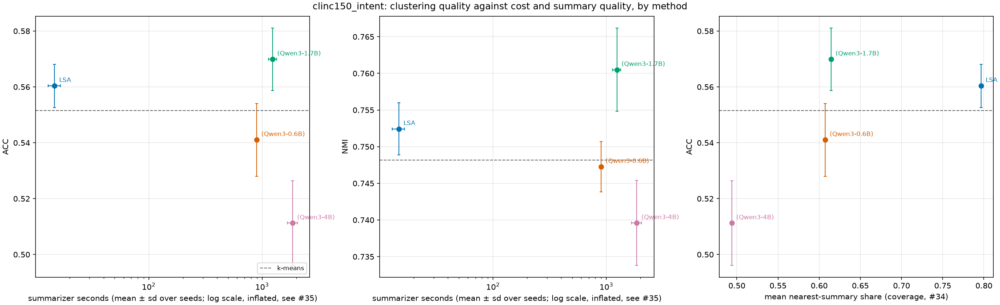
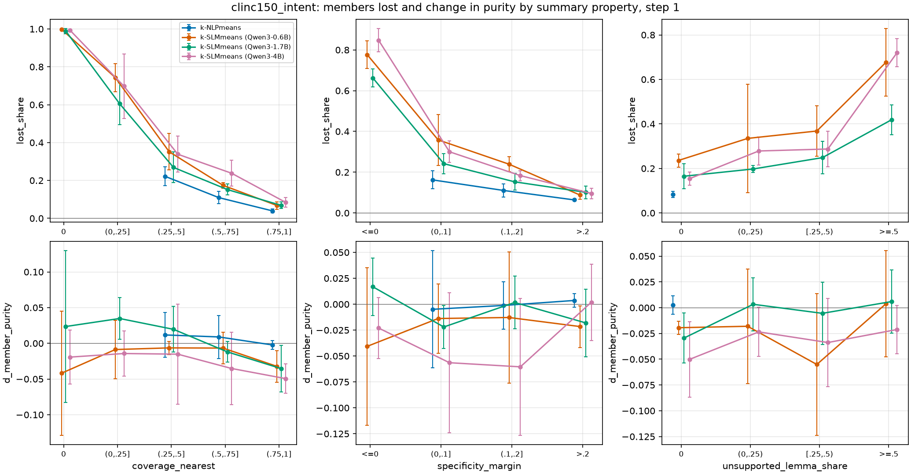
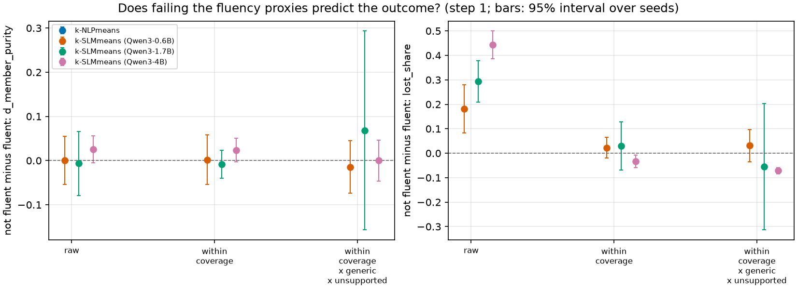
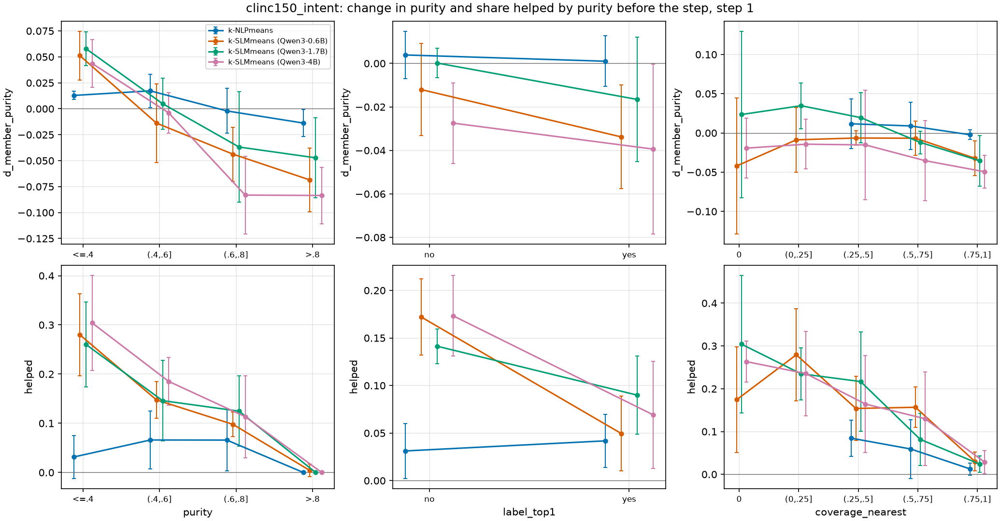

# When do generated summaries help or hurt clustering? First-cut synthesis (issue #50)

Status: **first cut, preliminary.** One analysis that joins summary quality (#34), centroid replacement (#33), clustering outcome and cost (#35) per cluster and per method. Everything here is an **association**; it does not say what causes what (that is #47, whose stage 1 is still running, so nothing from it is used). Written for the Nov 16 submission; the final version follows the Nov 17 review and the remaining runs (#18 BBC, #48 arXiv, #46 prompt v2), which the script takes as extra run directories.

## 1. What was joined

`scripts/synthesis.py` (module `src/kslimeans/synthesis.py`) writes one row per (dataset, method, seed, summary step, cluster) to `results/synthesis/synthesis_per_cluster.csv` (gitignored, 16,540 rows x 111 columns; regenerate with the command in section 8). Its columns:

| Family | Columns (source) |
| --- | --- |
| Summary quality | nearest-summary share, intent coverage, specificity margin, max cosine to another summary, unsupported-lemma share and flags, the six fluency proxies and `n_flu_flags`, `flag_generic` and its parts (#34) |
| Centroid representation | `drift` (RMS radii), `cosine`, `own_nearest`, `empty_replacement`, `size_replacement`, members out/in at the replacement and at the end of the block, `jaccard_end_vs_pre`, stale-summary flags (#33) |
| Outcome | `purity` before and `purity_after` (#34), `d_purity`, `lost_share`, `gained_share`, the majority intent before and after and whether they agree, `d_jaccard_major`, `member_agree_after` and `d_member_purity` (below), `helped` / `harmed`, each run's final ACC / NMI / ARI and the k-means run of the same seed |
| Cost | `input_tokens`, `output_tokens` of the cluster's prompt and summary, `sent` (False: a memo-cache hit or empty cluster, cost 0), run totals incl. `summarizer_seconds` |

**Indexing and the join.** #34 numbers summary steps from 0 and #33 from 1. Verified on the data: #34 step `j` matches #33 step `j + 1` (a join without the shift matches nothing at step 0 and mismatches everywhere else). The joined `step` is #33's (first summary = 1); `quality_step` keeps #34's. Runs are matched on the config name, never on the method (#34 uses the label, #33 the raw name `k-SLMmeans`, which is shared by the three Qwen runs). The join asserts one-to-one matches in both directions and fails on any unmatched or duplicated key; nothing is dropped silently. Match counts (`synthesis_join_report.csv`):

| Join | Rows | Matched | Left only | Right only |
| --- | ---: | ---: | ---: | ---: |
| #34 x #33 clusters, each of the 4 CLINC150 runs | 3,750 | 3,750 | 0 | 0 |
| #33 clusters x #33 stale flags | 15,000 | 15,000 | 0 | 0 |
| #34 x rebuilt after-block partition (outcome, majority) | 15,000 | 15,000 | 0 | 0 |
| #34 x rebuilt cost rows | 16,540 | 16,540 | 0 | 0 |
| #34 x step-1 references (counterfactual, shuffle null) | 3,000 | 3,000 | 0 | 0 |
| cluster rows x run metrics (many to one) | 16,540 | 16,540 | 0 | n/a |

The four BANKING77 runs (1,540 rows) have no #33 data and are kept with `has_diag == False`. The majority intent rebuilt from the logs equals #34's `majority_intent` in all 15,000 CLINC150 rows (asserted). Cost reconciliation against the logged totals (per seed): clusters sent equal the logged `n_calls` exactly, input tokens equal `input_tokens` exactly (tokens are rebuilt with the live `hf.fit_and_render` path, tokenizer only), and output tokens plus one EOS per call are within 15 tokens of `output_tokens` per seed, the residual #35 reports.

**Exact versus replayed (#33 section 2).** The #33 columns come from a replay of the logged blocks that starts from the logged summaries re-embedded on the GPU, and that replay is exact: share of clusters where the replayed state agrees with the log (`synthesis_replay_consistency.csv`) is 100% in every cell, for every method and step, both for the replayed pre-replacement cluster having the logged members (steps 2-5) and for the replayed end-of-block size equalling the logged one (steps 1-5). So the replacement-time columns and the `*_end` columns of #33 are exact at every step, not only at step 1. `step1` still marks the step-1 rows; the tables below give **step 1** first and "all steps" as a check. The outcome columns come from the logged partitions at every step, and they, not the `*_end` columns, are the outcomes used here. (The first version of this analysis used CPU-encoded summaries, for which this was not true: the replayed pre-replacement cluster had the logged members in only 33-48% of the 4B's clusters at steps 2-5 and the end-of-block size matched for 48% at step 1, 0.6B 74%; #33 section 2 shows this was encoder noise. The only numbers in this note that moved with the GPU embeddings are the step-1 empty-cluster counts and the number of defined step-1 correlations in section 3; no reading changed.)

**Outcome definitions.**

- `lost_share` is the share of the cluster's source members that sit elsewhere after the step's Lloyd block. It measures **disruption**, not damage.
- `d_purity` is `purity_after - purity` for the cluster id. When a cluster loses nearly everyone, the id afterwards holds other documents, so `d_purity` then compares different sets (and is mean-reverting: low-purity clusters have room to rise).
- `d_member_purity` follows the **members**: the share of the cluster's source members whose gold intent is the majority intent of the cluster they end in, minus the cluster's purity before. Weighted by cluster size these sum to the change in overall purity. This is the harm/help outcome used below; `helped` / `harmed` mean `d_member_purity` >= +0.1 / <= -0.1.
- With no no-replacement counterfactual per cluster in #33's file, the changes include what plain Lloyd would have done; LSA (extractive, almost no drift) is the in-table reference.

**Statistics.** The seed is the unit. Every interval is the Student-t interval of per-seed values (stratum means, or Spearman correlations computed within each seed), 4 degrees of freedom with 5 seeds, so intervals are wide on purpose; cells with fewer than 3 seeds (or fewer than 3 clusters per seed and stratum) are blank. Partial correlations regress the ranks of the controls (pre-step purity and log cluster size; for fluency also coverage, margin, unsupported share) out of both ranks. Seeds are paired across methods (every method starts from the same step-0 partition per seed) but each table treats methods separately. No multiple-comparison correction was made: about 120 strata and 480 correlations were computed, so a lone interval that excludes 0 is weak evidence.

## 2. Q4 Method level: quality, ACC and cost



Left and middle: ACC and NMI against summarizer seconds (log scale; mean +/- sd over 5 seeds; same error-bar style as `rq2_clinc150_pareto.png`, k-means dashed). Right: ACC against mean nearest-summary share at the last step. Seconds are inflated (about 1.7x, shared GPU, batch 8/4/1; #35) and are only a rough cost axis; tokens are in the table.

CLINC150, quality at the last summary step (`synthesis_clinc150_intent_methods.csv`):

| Method | nearest-summary share | specificity margin | unsupported share | generic | not fluent | ACC | NMI | dACC vs k-means [95% over seeds] | summarizer s | input / output tokens per seed |
| --- | ---: | ---: | ---: | ---: | ---: | ---: | ---: | ---: | ---: | ---: |
| LSA | 0.796 | 0.250 | 0.000 | 0.00 | 0.01 | 0.560 | 0.752 | +0.009 [0.001, 0.017] | 15 | 0 / 0 |
| Qwen3-0.6B | 0.607 | 0.146 | 0.128 | 0.17 | 0.29 | 0.541 | 0.747 | -0.010 [-0.018, -0.002] | 896 | 1.11M / 10.2k |
| Qwen3-1.7B | 0.614 | 0.112 | 0.304 | 0.21 | 0.09 | 0.570 | 0.760 | +0.018 [0.004, 0.033] | 1,239 | 1.10M / 18.3k |
| Qwen3-4B | 0.494 | 0.003 | 0.454 | 0.47 | 0.35 | 0.511 | 0.740 | -0.040 [-0.058, -0.022] | 1,855 | 1.12M / 15.6k |

- **Quality does not rank ACC.** The 1.7B has the highest ACC and NMI with coverage about equal to the 0.6B's and a lower margin and more unsupported content than the 0.6B; LSA has the best quality scores and a smaller gain. The 4B, worst on coverage, margin, duplicates and unsupported content, is the furthest below k-means (-0.040 ACC [-0.058, -0.022], paired by seed), and the 0.6B is also below it (-0.010 [-0.018, -0.002]). These are uncorrected 5-seed intervals, so the 0.6B's is weak evidence. With four methods this is a description of co-occurrence, not a fit.
- **Cost buys nothing monotone.** Every model size sends about 1.1M input tokens per seed (they share a tokenizer); output tokens differ (10k, 18k, 16k). LSA at about 1/60 to 1/120 of the summarizer time has a gain (+0.009 [0.001, 0.017]) that is not distinguishable from the 1.7B's (+0.018 [0.004, 0.033]; both intervals are uncorrected, 5 seeds). The 1.7B's is the only model gain whose interval excludes 0 in the positive direction; the 0.6B and 4B are below k-means.
- BANKING77 (`synthesis_bank77_pareto.png`, approximate partition, no cost columns: those runs predate #30): ACC 0.449 / 0.440 / 0.436 / 0.444 for LSA / 0.6B / 1.7B / 4B against k-means 0.435; paired gains are +0.014 [0.006, 0.022] for LSA and not distinguishable from 0 for the three models (intervals span 0). Quality ranks the same way as on CLINC150 (nearest-summary share 0.80 / 0.74 / 0.68 / 0.68).

## 3. Q1 Harm: which summary properties predict it?

Figure `synthesis_clinc150_intent_harm_strata.png` (step 1; top: lost share, bottom: `d_member_purity`; bars are 95% intervals over seeds). Full tables: `synthesis_clinc150_intent_harm_strata.csv`, `synthesis_clinc150_intent_correlations.csv`, `synthesis_tables.md`.



Step 1, mean over seeds (Qwen3-0.6B / 1.7B / 4B; LSA in brackets where defined):

| Cluster set | lost share | d_member_purity |
| --- | --- | --- |
| all clusters | 0.31 / 0.26 / 0.44 (LSA 0.08) | -0.020 / -0.006 / -0.032 (LSA +0.003) |
| nearest-summary share (0, .25] | 0.74 / 0.60 / 0.70 | -0.009 / +0.035 / -0.014 |
| nearest-summary share (.75, 1] | 0.07 / 0.07 / 0.09 | -0.032 / -0.035 / -0.049 |
| specificity margin <= 0 | 0.78 / 0.66 / 0.85 | -0.041 / +0.017 / -0.023 |
| specificity margin > .2 | 0.09 / 0.10 / 0.10 | -0.022 / -0.018 / +0.002 |
| generic flag, yes | 0.73 / 0.58 / 0.75 | -0.030 / +0.018 / -0.015 |
| generic flag, no | 0.20 / 0.16 / 0.17 | -0.017 / -0.013 / -0.045 |

- **Members lost track the summary properties closely.** Rank correlation with `lost_share` at step 1 (mean over seeds): nearest-summary share -0.78 / -0.72 / -0.83 (0.6B / 1.7B / 4B), specificity margin -0.63 / -0.51 / -0.77, generic flag +0.50 / +0.42 / +0.66, unsupported share +0.31 / +0.27 / +0.63, cosine between pre-center and summary -0.63 / -0.51 / -0.75; all intervals exclude 0 and survive partialling out purity and size (e.g. coverage -0.73 / -0.64 / -0.80). **This is largely built in**: the nearest-summary share is the share of members whose nearest summary is this cluster's, so members lost at the replacement is roughly one minus it; margin, drift and the generic flag are the same geometry again. Exact-duplicate summaries (the 4B has 94 of 750 clusters at step 1) lose 99.8% of their members by construction. The disruption is real, but it is evidence that the scores measure what they say, not an independent finding about harm.
- **Change in purity is not predicted by them.** `d_member_purity` against every quality property, partialling out purity and size, step 1: all rank correlations lie between -0.13 and +0.15 and all but a few intervals include 0 (coverage -0.02 to +0.08, margin +0.04 to +0.13, unsupported share -0.06 to +0.03, generic flag -0.11 to +0.06); with all steps pooled the same holds (all |rho| <= 0.09). Five of the 64 step-1 intervals (55 are defined) exclude 0: 0.6B specificity margin +0.127 and own-nearest +0.152, 1.7B intent coverage -0.130, 4B specificity margin +0.061 and duplicate flag +0.085. The signs are mixed (margin, own-nearest and duplicates point the "worse summary, better purity" way; the intent-coverage one the other way), the largest is 0.15, and about 3 of the 55 defined intervals (2.8) are expected by chance at the 5% level, so this is not a pattern. Without controlling for pre-step purity, `d_purity` correlates positively with the unsupported share and the generic flag (+0.05 to +0.22): those clusters are the low-purity ones, which gain on average.
- **What does predict the sign of the purity change is the purity before the step** (Q3 below): high-purity clusters lose purity, low-purity ones gain, for every Qwen model, far more than any summary property separates them.
- **Representation columns.** Own-nearest "no" (the summary is nearer another cluster's old center): lost share 0.78 / 0.67 / 0.84 against 0.21 / 0.17 / 0.19 for "yes". Drift above 1.5 RMS radii: 0.90 / 0.75 / 0.93 lost. `empty_replacement` is rare except for the 4B (6 / 3 / 54 of 750 clusters for the 0.6B / 1.7B / 4B at step 1). None of the representation columns predicts `d_member_purity` once purity and size are controlled (|rho| <= 0.15).
- **Summary of Q1.** The properties predict which members move, strongly and mostly by construction; they do not, in this data, predict whether the move improves or worsens the cluster's purity. A worse overall result appears at the method level (4B ACC -0.040, 0.6B -0.010), and the step-1 mean cluster `d_member_purity` is also negative for those two (-0.032 and -0.020, against LSA +0.003). These are different quantities (step-1 cluster means of a purity change against the final run's ACC after five steps) and are listed side by side, not linked; the cluster-level properties above do not explain the purity change, and what links a method's worse summaries to its worse ACC is not shown here (n = 4 methods; causes are #47's).

## 4. Q2 Fluency



Failing the fluency proxies is associated with large losses of members in the raw data, but not once coverage is accounted for.

| Outcome, step 1 | adjustment | 0.6B | 1.7B | 4B |
| --- | --- | ---: | ---: | ---: |
| lost share, not fluent minus fluent | raw | +0.18 [0.08, 0.28] | +0.29 [0.21, 0.38] | +0.44 [0.39, 0.50] |
| | within nearest-summary-share strata | +0.02 [-0.02, 0.06] | +0.03 [-0.07, 0.13] | -0.03 [-0.06, -0.01] |
| | within coverage x generic x unsupported strata | +0.03 [-0.04, 0.10] | -0.06 [-0.31, 0.20] | -0.07 [-0.08, -0.06] |
| d_member_purity, not fluent minus fluent | raw | +0.001 [-0.054, 0.055] | -0.006 [-0.079, 0.066] | +0.025 [-0.005, 0.056] |
| | within coverage strata | +0.002 [-0.054, 0.058] | -0.008 [-0.040, 0.024] | +0.024 [-0.003, 0.050] |
| | within coverage x generic x unsupported | -0.014 [-0.074, 0.045] | +0.068 [-0.157, 0.293] | 0.000 [-0.047, 0.047] |

- The raw gap in lost share (0.18 to 0.44) is almost entirely the lower coverage of the summaries that fail a proxy; the 4B's fluency failures are the prompt echoes, quotes and missing "?" that go with its duplicate and "main theme of the cluster" summaries (#34). Within coverage strata the gap is 0.02 to 0.03 for the 0.6B and 1.7B (intervals include 0) and slightly negative for the 4B (-0.03 [-0.06, -0.01], and -0.07 with the finer strata: not fluent summaries lose a little fewer members at equal coverage).
- Partial rank correlation of the number of failed proxies with `d_member_purity`, controlling for coverage, margin, unsupported share, purity and size: +0.06 / +0.01 / -0.02 / -0.01 (LSA / 0.6B / 1.7B / 4B), all intervals include 0; with lost share: +0.03 / +0.05 / +0.11 / -0.02, also including 0 (1.7B [-0.00, 0.23]). All-steps pooling gives the same picture.
- So in this data fluency does not predict the outcome beyond coverage and genericity, as the professor's point suggests. The proxies are cheap surface checks (#34), and the 0.6B and 1.7B have few strata with both groups at step 1; the 1.7B's wide intervals reflect that.

## 5. Q3 When do summaries help?



At step 1, 12.7% / 12.3% / 14.3% of the 0.6B / 1.7B / 4B clusters are `helped` (member purity up by at least 0.1) and 12.7% / 9.6% / 15.1% `harmed` (LSA 3.6% / 2.5%). Helped and harmed are about equally common.

**Two references.** The cluster-level change in members' purity has no meaning on its own: part of any change is what the same data would do anyway, and "purity before" is a maximum over the cluster's own members, so members tend to agree less with the majority of wherever they land than with the majority they came from, whatever moved them (plurality-selection asymmetry). So the change is compared with two references, both at step 1 (`synthesis_clinc150_intent_help_reference.csv`, figure `synthesis_clinc150_intent_help_reference.png`):

- **No-replacement counterfactual** (#33's): plain Lloyd for the same 20 iterations from the exact step-0 state (`kslimeans.replay`; step 0 replays the logged partition exactly in all 20 cases, asserted). It does not depend on any summary or embedding. It is the same for every method of a seed and barely moves anything: the share of members lost is 0.012 and the mean `d_member_purity` +0.001 [-0.001, 0.002] (helped 0.4%, harmed 0.3%). So the purity changes below are not "what Lloyd would have done anyway"; they are produced by the replacement step plus the Lloyd block it starts. It is not dose-matched: it moves 1% of members, the summaries 26-44%.
- **Random-shuffle null**: each cluster's members are moved at the cluster's own logged loss (its `lost_share`) to uniformly random other clusters (mean of 20 draws per cluster and seed). It is dose-matched and includes the plurality asymmetry: the mean `d_member_purity` is -0.12 (1.7B), -0.15 (0.6B), -0.22 (4B), and -0.04 for LSA, and negative in every purity stratum.

Step 1, mean over seeds [95% interval over seeds] of the summary step's `d_member_purity` minus each reference (all strata, including LSA, in `synthesis_tables.md`):

| Purity before | LSA minus counterfactual | 0.6B | 1.7B | 4B | 0.6B minus null | 1.7B minus null | 4B minus null |
| --- | ---: | ---: | ---: | ---: | ---: | ---: | ---: |
| all (750) | +0.002 | -0.021 [-0.037, -0.005] | -0.007 [-0.018, 0.005] | -0.032 [-0.046, -0.019] | +0.131 | +0.114 | +0.188 |
| <= 0.4 (187) | +0.012 [0.007, 0.016] | +0.050 [0.024, 0.076] | +0.057 [0.039, 0.074] | +0.042 [0.018, 0.067] | +0.182 | +0.184 | +0.214 |
| (0.4, 0.6] (192) | +0.013 [0.003, 0.024] | -0.018 | +0.001 | -0.008 | +0.161 | +0.146 | +0.213 |
| (0.6, 0.8] (133) | -0.003 | -0.044 [-0.070, -0.019] | -0.038 | -0.084 [-0.120, -0.047] | +0.119 | +0.100 | +0.220 |
| (0.8, 0.9] (69) | -0.000 | -0.084 [-0.145, -0.023] | -0.072 | -0.058 | +0.155 | +0.060 | +0.262 |
| > 0.9 (169, 22.5%) | -0.017 | -0.060 [-0.103, -0.018] | -0.036 [-0.056, -0.016] | -0.090 [-0.137, -0.042] | +0.034 | +0.031 | +0.074 |

(Intervals are given where they exclude 0 or matter; see the CSV for all. The "minus null" intervals exclude 0 in all rows except the three smallest-effect ones for the 0.6B and 1.7B at > 0.9 and 1.7B at (0.8, 0.9].)

- **Against random moves, the summaries' moves are better in every stratum** (+0.03 to +0.26), as expected of moves that follow embedding geometry; this is the dose-matched evidence that the movement is not random, in line with #33's movers table (toward-gold moves 24-31 times shuffled).
- **Against doing nothing (the counterfactual), the sign pattern holds**: the replacement raises member purity of mixed clusters (purity <= 0.4: +0.04 to +0.06 for the three models, intervals excluding 0, helped 26-30% against 0% for the counterfactual) and lowers it for pure ones (purity > 0.9: -0.04 to -0.09; (0.6, 0.8]: -0.04 to -0.08). LSA, which loses about 8% of members, shows the same sign pattern at a fraction of the size (+0.012 at <= 0.4, -0.017 at > 0.9), so it is a dose-response, not a property of the neural summaries; LSA is not dose-matched to the others and no dose-matched statement is made.
- **Ceiling.** Clusters with purity above 0.9 are 22.5% of the step-1 clusters and cannot be helped by +0.1 (purity cannot exceed 1), so their `helped = 0` cells are mechanical, and only "harmed" is informative there. The same applies, to a lesser extent, to (0.8, 0.9].
- **Size.** `d_member_purity` correlates with cluster size at step 1 (Spearman +0.13 LSA, +0.23 / +0.25 / +0.19 for the 0.6B / 1.7B / 4B; +0.05 to +0.15 after controlling for purity), because small clusters' purity before is inflated. Stratifying purity by size (<= 150, > 150 members; `purity_x_size` in the CSV) shows that the loss in the middle and upper purity strata is concentrated in small clusters: for purity (0.6, 0.8] the change minus the counterfactual is -0.09 / -0.11 / -0.145 for the small clusters and +0.00 / +0.02 / -0.03 for the large ones (0.6B / 1.7B / 4B), while the gain at purity <= 0.4 is larger in the large clusters (+0.06 / +0.07 / +0.05 against +0.04 / +0.04 / +0.04). Cells with fewer than 3 seeds contributing are blank (> 0.9 large clusters).
- **The `label_top1` association is not an explanation.** The summary being nearest to its cluster's majority-intent name goes with fewer helped clusters (0.05 / 0.09 / 0.07 against 0.17 / 0.14 / 0.17) and less lost share, but purity is not controlled in that comparison, and such clusters are the already-good ones. It was not tested whether the summary naming the intent matters at a given starting purity.
- **Not done.** The question as posed in #50, whether the summary pulls the centroid toward a gold intent that k-means had split or merged, needs split and merge detection (which gold intents are spread over several clusters, which clusters merge several), and that is not in this first cut. What is shown is where purity rises and falls, not that a rise is a repaired split or merge. `d_jaccard_major` (overlap with the cluster's majority intent) is in the joined CSV for it.

## 6. Q5 Datasets

- **CLINC150**: sections 2 to 5.
- **BANKING77 (approximate)**. Only the last summary step is scored, against the FINAL partition (#34's caveat), so there is no outcome for the step, no #33 columns and no per-cluster cost rebuilt from logged data (the join carries rebuilt input tokens flagged `cost_approx`, which assume every non-empty cluster was sent). `synthesis_bank77_cross_section.csv`: cross-sectional rank correlation of the properties with the cluster's purity in the final partition (mean over seeds). Nearest-summary share +0.43 / +0.52 / +0.47 / +0.56 (LSA / 0.6B / 1.7B / 4B), specificity margin +0.45 / +0.52 / +0.32 / +0.43, max cosine to another summary -0.47 / -0.31 / -0.40 / -0.39, unsupported share 0.00 / -0.18 / -0.16 / -0.10; the correlations of coverage and margin with purity are similar in size for LSA and the three models, and partialling out cluster size shrinks them but not to 0 (coverage +0.38 to +0.47). Fluency proxies: -0.06 to +0.10 and mostly intervals including 0. This says that good-covering, specific summaries sit on pure clusters, which is partly circular (a pure cluster has a mean that a summary can sit near) and cannot tell harm from help.
- **BBC (#18), arXiv (#48), prompt v2 (#46)**: not run; nothing here. Pass the run directories, their #34 per-cluster CSV and a #33 file that covers them to `scripts/synthesis.py`; runs absent from #33 are treated like BANKING77. Methods with the same label from different configs get `[config]` appended to the method id.

## 7. Limits

- One model family (Qwen3), one prompt per dataset, 5 seeds (intervals have 4 degrees of freedom; a stratum that is empty in a seed drops that seed).
- Replayed blocks and summary embeddings: the #33 columns (`drift`, `cosine`, `own_nearest`, `empty_replacement`, the `*_end` columns) use summary embeddings re-computed on the GPU and replayed blocks. The replay equals the logged blocks in every cluster at every step, so these columns are not noisy because of the replay. They do rest on one encode: a re-encode that differs at the 1e-6 level (another device or library version) changes up to about 9% of the 4B's labels after a block (#33 section 2), so the 4B's geometry strata are not robust to that. Quality and outcome columns come from the logged partitions and are not affected; the step-1 no-replacement counterfactual does not use summary embeddings and is exact.
- Associations in observational per-cluster data; summary quality, geometry and member loss are mechanically related (section 3). `d_member_purity` is purity against gold labels, one view of "better"; ACC/NMI/ARI are only available per run.
- Per-cluster cost is tokens only: the logs have one timed `summarize_batch` call per step, so seconds per summary exist only as run totals (inflated, #35). Per-cluster tokens mostly follow cluster size; cost was not analysed per cluster beyond the method level.
- No multiplicity correction; no hand check of #34's scores yet (pending), so the unsupported and generic flags carry their own known looseness.
- The conclusions below are the first-cut reading and will be revisited with #47, the Nov 17 review and the remaining runs.

## 8. Reproduce

```bash
export HF_HUB_OFFLINE=1 CUDA_VISIBLE_DEVICES=""; R=../k-slimeans/results   # the logged runs, #33 files and cache
python scripts/summary_quality.py $R/clinc150_lsa/20261027-174631 $R/clinc150_qwen3-0.6b/20261027-190908 \
    $R/clinc150_qwen3-1.7b/20261027-202532 $R/clinc150_qwen3-4b/20261027-221042 $R/prelim_bank77_*/* \
    --cache-dir ../k-slimeans/cache --out-dir results/summary_quality          # about 4 min wall (12 cores)
# the #33 per-cluster files must come from the GPU-embedding replay (#33 section 9): first
#   python scripts/embed_logged_summaries.py <run dirs> --cache-dir ../k-slimeans/cache \
#       --out $R/replacement_diagnostic/summary_embeddings_cuda.npz --device cuda            # GPU, about 20 s
#   python scripts/replacement_diagnostic.py <run dirs> --cache-dir ../k-slimeans/cache \
#       --summary-embeddings $R/replacement_diagnostic/summary_embeddings_cuda.npz --out-dir <scratch dir> \
#       --work-dir $R/replacement_diagnostic   # writes replacement_diagnostic_{clusters,stale}.csv
python scripts/synthesis.py <the same run dirs> --cache-dir ../k-slimeans/cache \
    --quality-clusters results/summary_quality/summary_quality_per_cluster.csv \
    --diag-clusters $R/replacement_diagnostic/replacement_diagnostic_clusters.csv \
    --diag-stale $R/replacement_diagnostic/replacement_diagnostic_stale.csv --out-dir docs/results   # about 7 min in the GPU-embedding rerun
```

With the CPU-encoded fallback (`summary_embeddings_cpu.npz`) the same commands run but `synthesis_replay_consistency.csv` is no longer 1.000 (the 4B's replayed blocks differ from the logs), and the step >= 2 and geometry columns for the 4B carry that noise.

CPU only (the scripts hide the GPU; tokenizers load from the local cache). Outputs: `synthesis_tables.md` (all tables), `synthesis_join_report.csv`, `synthesis_replay_consistency.csv`, `synthesis_<dataset>_{methods,harm_strata,help_strata,help_reference,correlations,size_corr,fluency,fluency_partial,cross_section}.csv`, and the figures `synthesis_<dataset>_{pareto,harm_strata,help_strata,help_reference,fluency}.png`.

## 9. What the evidence so far suggests about when summaries help or hurt (preliminary)

On CLINC150, a summary changes which members a cluster keeps in proportion to how well it covers them and how specifically it describes them, and by construction: summaries that cover few of their own members or that duplicate another cluster's dissolve their cluster. Whether that movement helps or hurts a cluster's purity is, in this data, mostly a matter of where the cluster started: against plain Lloyd without a replacement (which barely moves anything at step 1) mixed clusters improve and pure ones get worse, for every model, and against random moves of the same size the summaries' moves are much better than random, while none of the coverage, genericity, unsupported-content, fluency or drift measures separates the improved from the worsened clusters once the starting purity and size are accounted for. Fluency adds nothing beyond coverage. At the method level the final ACC is below k-means for the 4B (-0.040, the method with the worst coverage and most duplicates, so these co-occur across four methods) and, weakly, the 0.6B (-0.010), and above it for the 1.7B (+0.018) and the extractive LSA control (+0.009), with no monotone relation to summary quality or to cost; the cluster-level data above do not show that the bad summaries are what lowered ACC, and causes are #47's question. A reading consistent with the cluster-level data, not tested here, is that summary-then-Lloyd steps help low-purity clusters and hurt pure ones, so that a method's net effect depends on how many of each it has. This rests on one model family, one prompt, five seeds and an association-only design, and should not be read as more.
